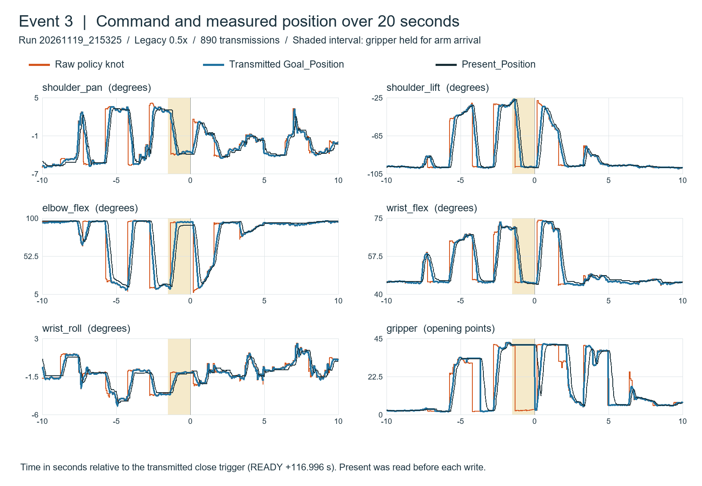

# 11월 20일 아침 · 약통 A → 파란 바구니 현장 시험

**첫 시험은 조명을 켠 뒤 93번 시연을 0.33배속으로 한 번 재생하는 것이다.** 21:53 대표 실패에서는 접근하던 팔의 목표 자체가 홈으로 되돌아갔다. 1.5초 닫힘 대기 만료 때 남은 팔꿈치 오차는 +3.62°였다. 물체를 집어 옮길 수 있는지는 같은 배치의 녹화 재생으로 먼저 확인한다.

## 최신 실물 실행

11월 19일 21:53:25 시작 기록(`20261119_215325`, 현장 `0498532`)을 분석했다. 아래 실측은 퇴근 전 실행의 값이다. 밤사이에는 실물 모터 쓰기 0회, live 실행 0회였다.

| 항목 | 결과 |
|---|---|
| 종료 | READY 후 180.397초, `RUN_COMPLETE`, 중도 정지 없음. 종료 자세 유지 확인은 5/5회 실패해 `HOLD_NOT_CONFIRMED`. 마지막 기록은 `TORQUE_RETAINED`, 포트 닫힘 |
| 전송·통신 | 7,964스텝. 연속 Goal 송신 간격 기준 평균 44.24 Hz, p5 30.20 Hz, 최소 5.05 Hz. 묶음 대기 합계 0초. 6축 모두 ID 불일치·−6·−7 각 0회 |
| 닫힘 대기 | 89회, 합계 23.220초. 도착 66회, 정책의 닫힘 철회 22회, 만료 1회 |
| 만료 | READY +116.991초, 1.5016초 대기. 정책−Present는 어깨 회전 +0.30°, 들기 +0.33°, 팔꿈치 +3.62°, 손목 굽힘 +0.33°. +116.996초에 그리퍼 462틱 전송, 직전 실측 1,091틱 |
| 보호·기록 | 오른쪽 +6틱은 2개 구간 28스텝 적용. 온도 원시 최고 150°C, 100°C 이상 읽기 오류 4건, 2초 중앙값 최고 33°C. 집기 기록 트리거 32개. 실물 투입 성공 미확인 |

종료 유지에서 팔꿈치 읽기−쓰기 차이는 −72, +7, −24, −1, −7틱이었다. 뒤의 세 회는 6축 모두 직전 유지 명령과 일치했다. 목표 읽기 시차 가능성이 있으나 실제 유지 상태는 확인되지 않았다. 현장에서 다시 유지 확인 실패가 나오면 다음 동작으로 넘어가지 않는다.

## 원인 순위와 전송 경로

1. **오래된 관측에서 만든 목표가 접근 중인 목표를 바꿨다.** +114.231초에 홈 근처에서 요청한 정책 묶음이 +115.672초에 도착했다. 대기 시작 때 정책의 어깨 들기·팔꿈치는 −27.55°·+12.85°였다. +115.677초 첫 반영 시 실측은 −27.1°·+15.3°인데 새 원본 목표는 −97.9°·+94.7°였다. 원본 목표가 먼저 바뀌고 전송 Goal과 팔이 뒤따랐다. 32개 닫힘 트리거에서 채택된 관측의 나이는 1.57~2.87초, 중앙값 2.23초였다. 3번 트리거에서 확인한 인과 순서를 32개 전체의 실패 원인으로 일반화할 수는 없다.
2. **청크 혼합과 모터 추종이 서로 다른 구간에서 오차를 보탰다.** 아래 표의 전후 20초 동안 팔꿈치 오차 p95는 원본−혼합 29.24°, 혼합−보간 7.31°, 전송−Present 28.40°였다. 만료 직전에는 팔꿈치 실측이 91.30°에 머물고 속도 raw 0, 부하 −196~−172, 전류 11~20 raw였다. 마지막 전송−Present는 +3.69°였다. 정지 상태의 잔여 오차는 확인되며, 중력·마찰·접촉을 각각 판별할 실측은 없다. 이전 21:03 닫힘의 어깨 −54.6°·팔꿈치 +60.0°는 별도 실행이다.
3. **고정 20°/s 상한과 팔꿈치 안전 클리핑은 이번 만료의 설명력이 낮다.** 20°/s는 별도 시험 프로필에 있고 운영 legacy에는 적용되지 않았다. 7,964개 전송의 6축 보간값을 재구성해 원 로그와 대조했다. 0.5배속은 정책 행 간격을 33.3→66.7 ms, 50행 소비 시간을 1.67→3.33초로 늘린다. 전체 클립은 1,349스텝(팔꿈치 1,216, 어깨 들기 24, 그리퍼 109), 대표 ±10초 팔꿈치 33회, 만료 대기 중 67개 전송에서는 0회였다. 만료 때 팔꿈치 Goal은 3,064틱으로 상한보다 20틱 안쪽이었다.



만료 직후 닫힘 송신 스텝을 기준으로 정렬했다. p95는 앞뒤 10초의 890개 송신에서 구한 절대 차이다. 그리퍼는 개방도 점, 팔은 도 단위다. Present는 같은 루프의 쓰기 직전 값이다.

| 축 | 원본−혼합 p95 | 혼합−보간 p95 | 전송−실측 p95 | 닫힘 때 정책 / 전송 / 실측 | 부하 / 전류 raw |
|---|---:|---:|---:|---|---|
| 어깨 회전 | 3.26 | 0.84 | 2.20 | −3.61 / −3.56 / −3.91 | −32 / 1 |
| 어깨 들기 | 22.13 | 5.07 | 21.77 | −98.09 / −97.98 / −98.42 | −44 / 1 |
| 팔꿈치 | 29.24 | 7.31 | 28.40 | 94.91 / 94.99 / 91.30 | −172 / 11 |
| 손목 굽힘 | 10.61 | 2.33 | 7.08 | 45.12 / 45.14 / 44.79 | −32 / 0 |
| 손목 회전 | 1.18 | 0.48 | 1.05 | −1.00 / −1.01 / −1.10 | 0 / 0 |
| 그리퍼 | 12.79 | 3.49 | 20.08 | 3.03 / 3.00 / 41.49 | 20 / 0 |

## 학습 속도와 추가 옵션

137회, 63,551프레임의 회차 내부 인접쌍 63,414개에서 action 차분 × 30 Hz를 계산했다. 앞 세 열은 0.5배속으로 환산했다. 마지막 열은 최신 실물 송신이며 위 그래프의 20초에 해당한다.

| 축 | 학습 p95 × 0.5 | 학습 p99 × 0.5 | 학습 최대 × 0.5 | 운영 전송 p95 |
|---|---:|---:|---:|---:|
| 어깨 회전 °/s | 13.19 | 26.37 | 109.45 | 25.48 |
| 어깨 들기 °/s | 42.20 | 68.57 | 216.26 | 170.14 |
| 팔꿈치 °/s | 50.11 | 88.35 | 237.36 | 223.75 |
| 손목 굽힘 °/s | 27.69 | 46.15 | 184.62 | 69.20 |
| 손목 회전 °/s | 7.91 | 21.10 | 68.57 | 12.66 |
| 그리퍼 점/s | 32.16 | 70.06 | 240.05 | 91.35 |

- `--vel-limit data`는 학습 action p99 × 요청 배속으로 각 축의 최종 전송 변화량을 제한한다. 실측에서 시작하고 제어 정체 중의 속도 여유를 누적하지 않는다. 접근 지연을 더 늘릴 수 있어 첫 시험에서는 끈다.
- `--assist-grasp`는 원본 정책·보간 목표·실측의 팔 5축이 모두 학습 닫힘 중앙값에서 5° 이내이고 정책이 닫힘을 요구할 때만 작동한다. 실측 열림을 0.30초 유지하며 축별 최대 5° 보정하고 다음 0.30초에 해제한다. 실행 기록은 **VLA + 집기 보조**로 구분한다. 최신 로그 7,964행에 조건을 대입하면 발동 후보는 **0행**이었다.
- `--replay 93`은 파랑 44회 중 438프레임(중앙값 437.5), 닫힘 후보 181번 프레임(중앙값 175)의 시연을 한 번 재생한다. 동작 순서와 원 action, 보호 후 목표, 실제 전송값을 나누어 기록한다. 나머지 두 옵션과 정책은 사용하지 않는다. 홈 검사·오른쪽 +6틱·집기 기록·그리퍼/팔꿈치·온도·ID 보호를 공유한다. 기존 legacy 기본값은 그대로다.
- 화면의 **녹화 재생용 약통 A 위치**를 켜면 640×480 수직 카메라 (318.94, 164.60), 사선 (312.52, 225.37)에 노란 십자가 뜬다. 대상은 약통 뚜껑 ID 9이다. 손목 첫 프레임에서는 뚜껑이 보이지 않아 위치를 표시하지 않는다.

## 저장 영상에 대한 실제 모델의 반응

Jetson Orin에서 운영 체크포인트(`b84b15c70ee7`), 저장된 3뷰 JPEG와 6축 state로 5개 시점 × 5조건, **25회** 재추론했다. 각 입력은 50행, seed 101, 동일 입력 반복 차이 최댓값 0이었다. 영상과 요청 대응 시차는 대표 세 요청에서 −23~+12 ms, 카메라 간 게시 시차는 11~39 ms였다. 원 실행의 비압축 이미지와 난수 상태는 보존되지 않았다.

| 저장 장면 | 동시각 state에서 시연 닫힘 범위에 든 팔 4축 행 / 50 | 같은 영상 + 1.5초 전 state | 동시각 추론 마지막 어깨 들기 / 팔꿈치 | 1.5초 전 state로 추론한 마지막 두 축 |
|---|---:|---:|---|---|
| 2번 정책 요청 | 8 | 0 | −22.4° / −3.6° | −96.0° / +90.9° |
| 3번 정책 요청(홈 근처) | 0 | 0 | −97.3° / +93.8° | −82.1° / +60.4° |
| 3번 닫힘 대기 시작(접근 후) | 47 | 0 | −18.3° / +2.5° | −70.5° / +43.0° |
| 29번 정책 요청 | 36 | 0 | −25.9° / +20.3° | −93.9° / +85.3° |
| 29번 닫힘 트리거 | 45 | 0 | −31.5° / +9.2° | −95.4° / +84.0° |

3번의 새 영상·새 상태로 재추론하면 어깨·팔꿈치가 당시 실측에서 **+11.2°·−15.1°** 더 접근하는 목표가 나왔다. 같은 JPEG에 과거 state를 넣으면 반대쪽으로 바뀌었다. 원래 홈 관측에서 만든 묶음은 자체 입력에 대해서는 홈 근처에 머물렀다. 재생 성공 시에는 같은 시각의 영상·state로 재추론하고 오래된 묶음을 채택하는 시점부터 오프라인 비교하는 것이 우선이다. 이 실험은 고정된 저장 장면에서의 모델 반응이며 실물에서 정책을 바꾼 결과는 아직 없다.

다만 3번 접근 직전의 동시각 재추론에서도 그리퍼 목표는 34.8~43.1점으로 시연 닫힘 상단 32.1점보다 열려 있었고, 6축 동시 진입은 0/50행이었다. 같은 영상에 1.5초 전 홈 근처 상태를 주면 마지막 그리퍼는 5.3점까지 닫혔다. 29번 닫힘 트리거에서는 동시각 입력의 6축이 19/50행에서 범위에 들었다. 과거 state를 인위적으로 넣은 결과와 원 live가 실제 사용한 입력은 구분해야 한다.

분포는 닫힘을 검출한 135/137개 학습 시연의 축별 5~95백분위다. 원 live 트리거에서 정책 6축이 모두 범위에 든 것은 29·30번, 실측 6축은 29번이다. 추가 시연이 필요하면 현재 카메라를 고정하고 **12회**를 먼저 기록한다. 수직 화면 기준 A의 재생 십자 중앙·좌 10 px·우 10 px × 정상 접근·조금 덜 도달한 접근 × 2개 세션이다. 각 조건에서 열림 유지→팔 정렬→닫힘→들어올림→파랑 바구니 놓기까지 녹화한다. 첫 세션 6회는 보강용, 다른 세션 6회는 평가 전용으로 보관한다. 기존 137회는 독립 평가에 쓰지 않는다.

## 밤사이 검증

**최종 Jetson 실카메라 dry-run 4건은 모두 저조도 HOLD, 정책/재생 전송 0스텝, 실물 모터 쓰기 0회였다.** 세 대에서 영상은 들어왔다. 기본 시험의 0~255 평균 밝기는 손목 0.97, 수직 0.21, 사선 7.15였다. 세 뷰 각각의 평균·p99 지표에 적용하는 기존 최솟값 10에 미달했다. 밝은 실카메라에서 180초 완주한 결과는 현장에서 추가 확인해야 한다.

| 옵션 | 실제 카메라 3대, 180초 상한 | 밝을 때 저장한 같은 3뷰 + 모의 팔 |
|---|---|---|
| legacy 기본 0.5 | 첫 유효 영상 대기 5.02초 후 HOLD | 실제 모델 60.00초, 2,968스텝, 추론 묶음 40개 |
| 데이터 속도 제한 0.5 | 5.01초 후 HOLD | 실제 모델 60.01초, 2,958스텝, 추론 묶음 40개 |
| 집기 보조 0.5 | 5.01초 후 HOLD | 실제 모델 60.01초, 2,977스텝, 추론 묶음 39개, 보조 발동 0회 |
| 녹화 재생 93, 0.33 | 5.003초 후 HOLD, 세 뷰 저조도, `not_started` | 정책 없이 44.62초, 438/438행, 집기 기록 트리거 2개, `source_exhausted`, 정리 오류 0건 |

저장 영상 검증은 같은 JPEG 세 장을 고정하고 모의 팔의 state를 갱신했다. 앞 절의 25회 재추론은 시각별 실제 저장 state를 사용한 별도 실험이다. 첫 개발 후보에서는 영상 디코딩만 확인한 재생이 어두운 상태에서도 438행을 소비했다. 이를 발견해 기존 공용 밝기 검사를 홈·토크 준비 앞으로 옮겼고, 최종 후보에서 첫 명령 전 중단을 확인했다. 카메라 전용 정렬 서비스를 복원하고 브라우저에서 두 노란 십자의 실제 픽셀과 켜기·끄기를 확인했다.

Jetson 최종 회귀는 전체 발견 246개, 내장 제어기 17개 통과. legacy·raw 진입점에서도 각각 5개·34개를 다시 통과했다(회귀 목록과 중복). 옵션별 모의 시나리오 48/48 통과. 9초 모의에서 기본 정책과 최종 전송값 449개는 배포 전과 해시가 일치했다. 보조의 근접 조건·상한·해제는 모의 입력으로 검증했다.

## 아침 실행 순서

- [ ] 조명을 켜고 손목·천장 수직·사선 영상이 모두 밝고 갱신되는지 확인한다. 관제 화면에서 노란 십자를 켠 뒤 두 천장 영상에 뚜껑 중심을 맞춘다. 파란 바구니 테두리도 학습 겹쳐보기로 맞춘다.
- [ ] 팔을 지지한 상태에서 홈 자세, 팔꿈치 상한 3,084틱, 그리퍼 개방 상한 48.5점 및 정지 수단을 확인한다. 작업 구역에서 손을 빼고 전원과 포트 상태를 확인한다. 텔레옵·녹화는 종료한다. 같은 위치로 되돌릴 수 있게 약통과 바구니 위치를 표시한다.
- [ ] **밝은 환경 dry-run 선행.** 아래 명령으로 3뷰와 438행 완주, `physical_motor_writes=0`을 확인한다. 정책을 시도할 때도 해당 명령의 `--live`를 `--dry-run`으로 바꿔 밝은 환경에서 먼저 통과시킨다.

```bash
bash ~/so101_vla/live/run.sh --mode legacy --dry-run --replay 93 --speed 0.33 --duration 180
```

**1. 운영자가 앞에 있을 때 녹화 재생 0.33.** 180초는 상한이다. 한 바퀴만 재생하며 438행의 명목 송신 시간은 약 44.1초이다.

```bash
bash ~/so101_vla/live/run.sh --mode legacy --live --execute --operator-present --replay 93 --speed 0.33 --duration 180
```

**2A. 들어올림·파랑 투입·종료 유지 확인까지 성공하면** 같은 자리에서 보조 없는 VLA를 비교한다.

```bash
bash ~/so101_vla/live/run.sh --mode legacy --live --speed 0.5 --duration 180
```

**2B. 집기 실패 또는 유지 미확인이라면** 다음 live는 보류한다. 조명과 물체 위치를 다시 맞춘 뒤 다음 명령으로 재생 입력·카메라·기록을 먼저 확인한다.

```bash
bash ~/so101_vla/live/run.sh --mode legacy --dry-run --replay 93 --speed 0.33 --duration 180
```

- [ ] 집기 기록에는 **닫힘 → 약통이 바닥에서 떨어짐 → 이동 중 유지 → 파란 바구니 안에서 놓임**을 각각 예/아니오로 남긴다. JPEG, source action, 보호 후 Goal, Present, 부하, HOLD 결과를 같은 시각으로 대조한다.
- [ ] 재생은 성공하고 VLA만 실패하면 장치가 적어도 그 궤적을 수행할 수 있음을 확인한 것이다. 재생도 실패하면 약통 배치, 원 action→전송(보호·보간), 전송→실측(추종·부하), 파지 후 미끄러짐 순으로 분리한다. `HOLD_NOT_CONFIRMED`, 홈 실패, 온도 중단, 포트 오류가 나오면 정지 상태부터 확인한다.
- [ ] 무보조 VLA가 닫힘 중앙값 5° 이내까지 반복해서 접근하고 파지만 실패할 때만 아래 보조 비교를 별도 시행한다. 물체가 들리고 놓인 결과를 무보조 통계와 분리한다.

```bash
bash ~/so101_vla/live/run.sh --mode legacy --live --assist-grasp --speed 0.5 --duration 180
```

내일도 승인된 모터 쓰기는 Torque_Enable, Goal_Position, 그리퍼 토크 한계뿐이다. 보정·P/I/D·가속도 레지스터 쓰기는 금지한다. 온도 2초 중앙값 55°C HOLD·50°C 경고, ID 불일치 재시도 조건은 유지한다.

## 버전

GitHub 운영 브랜치 `vla/live-202611`에서 코드 push 직후 원격 조회로 `c46f31eec5a347d56b54b6bb49184f55ab4f6476`을 확인했다. 현장 저장소는 디렉터리 구조와 이력이 별도이며 대응 코드는 `72f49f233e71386040553d7d20125826388a8c38`이다. 이전 도착 대기 커밋을 포함했고 오프라인 실험 브랜치 `c466e24`는 병합하지 않았다. 원본 JPEG·모델·시연 action·원문 통신 로그는 공개 커밋에서 제외했다. [코드 커밋](https://github.com/Phjrab/mediflow-robotics/commit/c46f31eec5a347d56b54b6bb49184f55ab4f6476)
