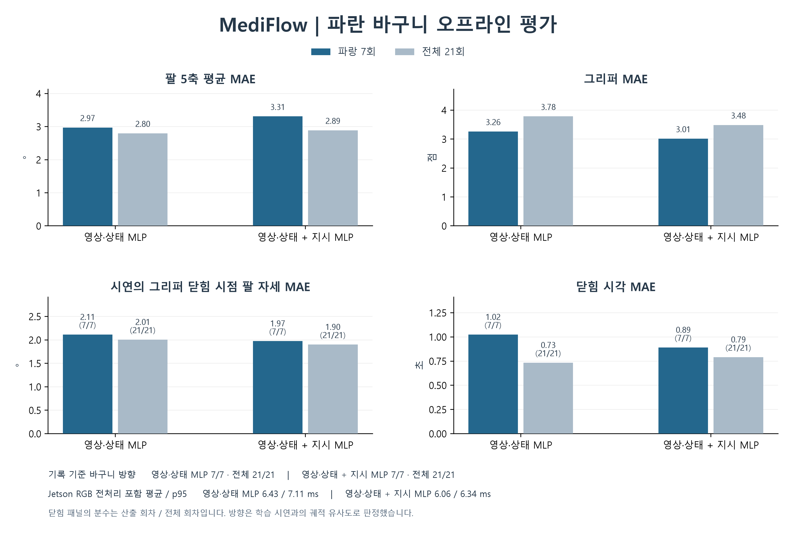
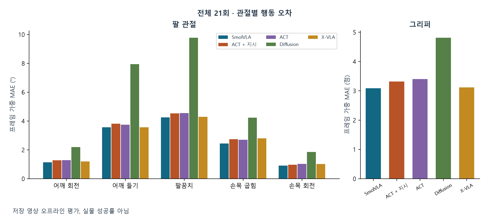
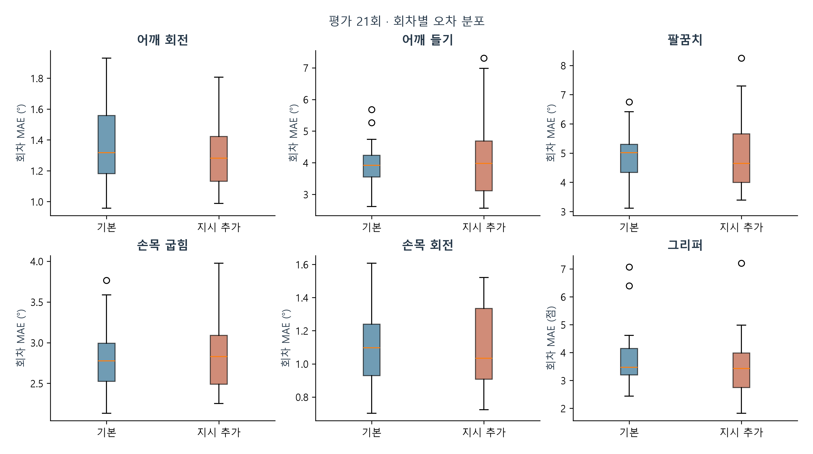
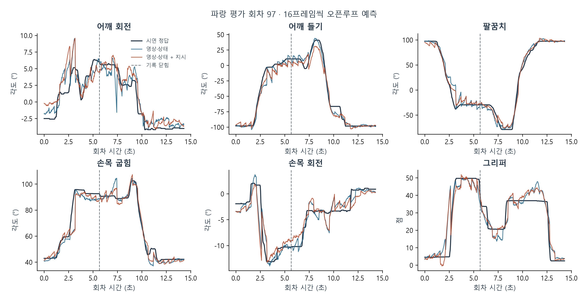
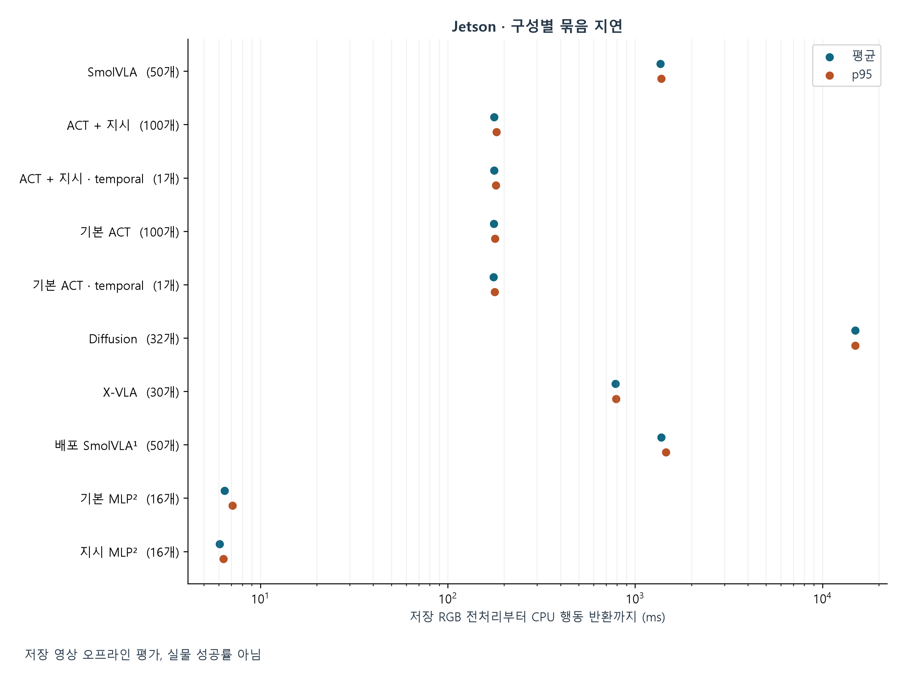

# MediFlow 약통 A · 정책별 오프라인 비교

### 파란 바구니 1개 작업 · 2026-11-23

**약통 A → 파란 바구니 실물 시험 1순위는 기존 배포 SmolVLA(b84b15c7…)다.** 실제 영상에서 투입 3건을 확인했고, 실행 중 사람이 약통을 다시 놓은 15:30 건을 제외해 2건을 후보 근거로 채택했다. [실행별 원문과 프레임](EVIDENCE_AUDIT.md)

MLP 2종은 오프라인 최소 기준선으로만 사용한다. 같은 저장 장면·관절 상태에서 지시만 바꾸면 새 바구니 방향과의 일치는 기본 0/42, 지시 MLP 1/42였다. 원래 지시가 붙은 파랑 7회에서의 일치 7/7은 녹화 장면이나 상태에 의존한 행동 재현으로도 설명된다. 이 시험으로 영상 암기만을 단일 원인으로 확정하거나 폐루프 방향 선택을 보장할 수 없어 두 모델 모두 실물 후보에서 제외했다. [지시 교체 시험](prompt_check.json)

| 평가 범위 | 모델 | 팔 5축 평균 MAE | 그리퍼 MAE | 닫힘 시각 MAE | 닫힘 자세 MAE | 닫힘 매칭 | 바구니 방향 일치 |
|---|---|---:|---:|---:|---:|---:|---:|
| 파랑 7회 | 영상·상태 MLP | 2.970° | 3.257점 | 1.024초 | 2.113° | 7/7 | 7/7 |
| 파랑 7회 | 영상·상태 + 지시 MLP | 3.306° | 3.011점 | 0.890초 | 1.974° | 7/7 | 7/7 |
| 전체 21회 | 영상·상태 MLP | 2.795° | 3.781점 | 0.733초 | 2.005° | 21/21 | 21/21 |
| 전체 21회 | 영상·상태 + 지시 MLP | 2.885° | 3.484점 | 0.790초 | 1.900° | 21/21 | 21/21 |

| 파랑 7회 전 구간 MAE | 어깨 회전 | 어깨 들기 | 팔꿈치 | 손목 굽힘 | 손목 회전 |
|---|---:|---:|---:|---:|---:|
| 영상·상태 MLP | 1.22° | 4.34° | 5.33° | 2.89° | 1.07° |
| 영상·상태 + 지시 MLP | 1.20° | 5.52° | 5.79° | 2.94° | 1.07° |

지시 MLP는 파랑에서 닫힘 순간의 자세를 더 가깝게 재현했다. 반면 전 구간의 어깨 들기와 팔꿈치 오차는 기본 MLP 쪽이 작았다.

3색 학습 116회를 유지했다. 파랑 평가는 전체 21회에 포함된 7회(3,163프레임)다. 팔·그리퍼 MAE는 프레임 가중 평균, 닫힘 지표는 매칭 회차 평균이다. 자세 오차는 시연이 닫힌 프레임에서 기록 행동과 예측 행동의 팔 5축 절대 차이다. 바구니 방향은 학습 회차 궤적의 최근접 색을 기준으로 계산했다. 두 MLP의 실물 투입률은 미측정이다. [기본 MLP 파랑·전체 집계](rgb_mlp_color_metrics.json) · [지시 MLP 파랑·전체 집계](rgb_mlp_task_color_metrics.json)

| 공식 정책 | 파랑 방향 일치 | 전체 방향 일치 | 학습 상태 |
|---|---:|---:|---|
| 새 SmolVLA | 미측정 / 7 | 미측정 / 21 | 20,000스텝 완료. 전체 평가 팔 5축 MAE 2.545°, 그리퍼 MAE 3.126점 |
| ACT + 지시 | 미측정 / 7 | 미측정 / 21 | 40,163스텝 저장, 40,000스텝 전체 평가 그리퍼 MAE 3.248점 |
| 기본 ACT | 미측정 / 7 | 미측정 / 21 | 시간 한도로 40,244스텝 저장. 40,000스텝 전체 평가 그리퍼 MAE 3.413점 |
| Diffusion Policy | 미측정 / 7 | 미측정 / 21 | 시간 한도로 12,194스텝 저장. 12,000스텝 전체 평가 그리퍼 MAE 4.243점 |
| X-VLA | 미측정 / 7 | 미측정 / 21 | 20,000스텝 및 전체 평가 완료. 그리퍼 MAE 3.115점 |
| π0.5 | 미측정 / 7 | 미측정 / 21 | 자원 확인 대기 |

기존 배포 SmolVLA는 평가 21회도 학습에 사용해 독립 오프라인 순위에서는 제외했다. 실물 시험 우선순위의 근거는 기존 배포본의 현장 영상이다.

Jetson Orin에서 저장한 3대 카메라 RGB의 전처리부터 CPU 행동 반환까지 다시 측정했다. 16개 행동 청크당 평균/p95는 기본 MLP **6.43/7.11 ms**, 지시 MLP **6.06/6.34 ms**였다. 모델마다 400회 측정했고 카메라 촬영과 영상 파일 해독은 계측 범위 밖이다. [원시 측정](jetson_rgb_latency.json)

참고 시험에서 기존 배포 SmolVLA의 지시 교체 후 요청한 방향과의 일치는 **11/42**였다. 원래 빨강·초록이었던 영상에서 파랑으로 지시를 교체한 결과는 **0/14**다. 이 값은 원래부터 파랑인 7회에서 파란 바구니를 향하는지를 묻는 평가와 분모·조건이 다르다. [교체 지시와 회차별 결과](historical_smolvla_prompt_check.json)

기존 배포 SmolVLA의 Jetson 저장 RGB 지연은 50개 행동 청크당 평균 1,368.70 ms, p95 1,385.15 ms였다. 예열 10회 후 42회를 계측했다. 위 MLP 지연의 청크 길이는 16개다. [배포 모델 지연 원자료](historical_smolvla_jetson_rgb_latency.json)

### 11월 22일 기준선 측정 기록

기본 MLP와 지시 MLP는 최소 기준선이다. 기존 시험에서 지시 MLP의 전체 21회 닫힘 자세 오차는 1.90°였고, RGB 축소 이후부터 계측한 Jetson 추론 p95는 1.23 ms였다.

이 비교에서 학습과 평가를 마친 정책은 CPU용 소형 MLP 2종이다. 요청한 SmolVLA·ACT·Diffusion·π0.5·X-VLA의 정식 GPU 학습은 미실행이다. 운영 체크포인트와 이전 빨강·초록 체크포인트는 비교에서 제외했다. 로봇 쓰기 0회. [실행 상태](STATUS.md)



### 환경과 모델별 가능 범위

| 호스트 | 확인한 자원 | 이번 사용 |
|---|---|---|
| 현재 Windows | Ryzen 7 5700U 8코어, RAM 15.35 GiB, Radeon 내장 그래픽, Windows가 보고한 어댑터 메모리 512 MiB, 디스크 여유 약 215 GiB | PyTorch 2.11.0+cpu, LeRobot 0.6.2. 소형 정책 학습, 저장 영상 분석 |
| 과거 학습 PC | 프로젝트 기록에 RTX 3060 12 GB | 현재 SSH 등록은 Jetson, 연결망에도 Jetson만 확인. 학습 PC의 현재 여유 VRAM·디스크·가동 여부 미확인 |
| 클라우드 | 조회한 Hugging Face 계정의 기존 Jobs 0개. 다른 학습 서버나 할당된 클라우드 GPU 미확인 | 유료 작업 생성·데이터 업로드 0건 |
| Jetson | Orin, PyTorch 2.8.0, CUDA에서 보이는 공유 메모리 7.43 GiB, 디스크 여유 47 GiB | 완성된 소형 정책의 순차 추론 지연 측정 |

아래 VRAM은 공식 가이드의 BS 8 기준 대략적인 범위다. 3카메라 구성의 피크와 학습 ETA는 해당 GPU에서 직접 측정해야 한다. [LeRobot 장비 가이드](https://huggingface.co/docs/lerobot/hardware_guide)

| 모델 | 참고 VRAM | 계획 step / batch | 이번 상태와 조건 |
|---|---:|---:|---|
| SmolVLA | 약 10–16 GB | 20,000 / 4 | CUDA 미할당. 공개 base부터 재학습. 3060에서 과거 설정의 재현 가능성 있음 |
| ACT · ACT + one-hot | 약 2–6 GB | 각 100,000 / 8 | 정식 학습 미실행. 기본 ACT CPU에서 실제 3뷰 1스텝 6.93초, 배치 1, 51,597,190 파라미터. 이 초기화·배치의 측정값으로 본학습 ETA를 산정하지 않았다 |
| Diffusion Policy | 약 8–14 GB | 100,000 / 8 | CUDA 미할당. 3060 12 GB에서는 3뷰 실측 필요 |
| π0.5 | 대형 VLA 약 24–40 GB | 20,000 / 1 | CUDA 미할당. BF16 및 gradient checkpointing 설정 |
| X-VLA | 대형 VLA 약 24–40 GB | 20,000 / 1 | CUDA 미할당. 단일팔 6축용 auto 설정과 MF-04 round2 순서 수정본 사용. 수정본 CPU 테스트 17개 통과. 새 실제 학습 가중치와 golden 재로딩 미실행 |
| GR00T N1.5 | 이 환경 실측 없음 | — | 설치된 0.6.2의 groot 설정이 N1.5 미지원을 명시한다. N1.5에는 별도 0.5.1 호환 환경과 GPU 필요 |
| 영상·상태 MLP · 지시 추가 MLP | CPU | 각 4,000 / 128 | 학습·평가·Jetson 지연 측정 완료 |

설치 환경의 정책 레지스트리 19개는 act, diffusion, eo1, evo1, fastwam, gaussian_actor, groot, lingbot_va, molmoact2, multi_task_dit, pi0, pi05, pi0_fast, smolvla, tdmpc, vla_jepa, vqbet, wall_x, xvla다. 레지스트리와 선택적 의존성의 실행 가능 여부를 구분했다. X-VLA 학습 설정은 공식 단일팔 auto 계약과 프로젝트 순서 검사를 따른다. [공식 X-VLA 안내](https://huggingface.co/docs/lerobot/xvla)

### 분할과 학습 조건

| | 빨강 | 초록 | 파랑 | 회차 | 프레임 |
|---|---:|---:|---:|---:|---:|
| 학습 | 41 | 38 | 37 | 116 | 53,709 |
| 평가 | 7 | 7 | 7 | 21 | 9,842 |

학습·평가 기준은 원본 회차다. seed 101로 각 색에서 7회씩 선정했다. 평가 ID는 빨강 3·12·22·29·32·34·37, 초록 61·62·66·69·79·86·92, 파랑 97·98·103·105·109·121·136이다. 훈련 시 섞는 단위와 평가 배정을 분리했다. 137개 원본 회차 ID가 모두 고유하며 세 카메라의 동일 영상 해시 내 원본 프레임 구간 중첩을 검사했다. 분리본은 주소를 다시 매긴 별도 Parquet과 원본 MP4의 회차별 시간 구간을 사용한다. 정규화 통계와 가장 가까운 투입 궤적 사전은 학습 회차만 사용했다. 평가 손실 추적에는 고정 최종 스텝을 적용했다. [분할 목록 및 원본 manifest SHA](split.json)

소형 모델은 손목·천장·사선 영상을 각각 8×6 RGB로 면적 축소한 뒤 6축 상태를 붙인다. 은닉층 128×128이 절대 행동 16개를 예측한다. 지시 추가 모델은 요청 색의 3차원 one-hot을 상태 뒤에 붙인다. 두 모델은 seed 101, AdamW, 학습률 0.001, 배치 128, 4,000스텝과 같은 시연 샘플링 규칙을 사용한다. 목표는 6축을 학습 통계로 표준화한 MSE다. 회차 끝을 넘어가는 학습 창은 제외했다. 1,000스텝마다 모델·옵티마이저·난수 상태를 저장했다. 학습 시간은 학습 루프의 벽시계 시간이고, 데이터 복원과 전체 영상 디코딩은 제외했다.

SmolVLA 계획은 원래 설정에서 batch 4, seed 101, 50-action chunk, denoising 10회, AdamW peak lr 0.0001, warmup 1,000, decay 30,000을 유지한다. 이번 평가 회차를 본 현장 가중치 대신 공개 base의 리비전을 고정했다. 원본 `b84b15c7…`는 평가표에서 제외했다. ACT·Diffusion은 자연어 지시를 입력받지 않는다. 시각·자세에 색 단서가 남아 있으면 일치율을 높일 수 있다. [훈련 설정·공개 모델 리비전](../../lerobot_training/model_compare/train_queue.py)

### 같은 평가 회차에서 얻은 결과

| 정책 | 파라미터 | 학습 step / 시간 | 팔 5축 평균 MAE / 그리퍼 | 닫힘 때 자세 / 시각 MAE | 바구니 방향 | Jetson 평균 / p95 |
|---|---:|---:|---:|---:|---:|---:|
| 영상·상태 MLP | 85,088 | 4,000 / 14.20초 | 2.80° / 3.78점 | 2.01° / 0.73초 | 21/21 | 1.18 / 1.84 ms |
| 영상·상태 + 지시 MLP | 85,472 | 4,000 / 14.30초 | 2.89° / 3.48점 | 1.90° / 0.79초 | 21/21 | 0.90 / 1.23 ms |

| 평가 MAE | 어깨 회전 | 어깨 들기 | 팔꿈치 | 손목 굽힘 | 손목 회전 | 그리퍼 |
|---|---:|---:|---:|---:|---:|---:|
| 영상·상태 | 1.36° | 3.85° | 4.87° | 2.81° | 1.09° | 3.78점 |
| 영상·상태 + 지시 | 1.30° | 4.19° | 4.96° | 2.88° | 1.10° | 3.48점 |

각 회차의 0번 프레임부터 16프레임마다 당시 저장된 관측을 한 번 입력했다. 그다음 최대 16개 행동을 새 관측 없이 예측하고 마지막 창은 회차 끝에서 잘랐다. 평가 9,842프레임을 한 번씩 채점했다. 전체 MAE는 프레임 가중치, 박스플롯은 회차별 평균이다. 닫힘은 기존 프로젝트의 열림 피크 및 3프레임 지속 규칙으로 찾았다. 기록·예측 모두 21회에서 검출됐다. 자세 오차는 정답이 닫힌 프레임에서 예측 행동과 기록 행동의 5축 절대 차이다. 모터 실측 추종 오차와는 정의가 다르다. [기본 정책 회차별 결과](rgb_mlp.json) · [지시 추가 정책 회차별 결과](rgb_mlp_task.json)

투입 방향은 기록 궤적의 닫힘 후 그리퍼가 다시 열리는 시점 직전 1초를 사용했다. 학습 116회 중 열림이 검출된 108회에서 5축 궤적을 비교해 표준화 거리의 최근접 색을 골랐다. 기록된 평가 정답 궤적으로 산식 자체를 확인한 결과는 21/21이었다. 기록된 영상·상태를 고정하고 나머지 두 색을 각각 요청했을 때는 기본 정책 0/42, 지시 추가 정책 1/42였다. 오프라인 교체 지시는 과거 행동에 의해 만들어진 관측과 모순될 수 있다. [산식 대조](metric_check.json) · [지시 교체 결과](prompt_check.json)

### Jetson 지연과 처리량

| 정책 | 평균 / p95 | 청크 환산 행동/초 | PyTorch 최대 할당 / 예약 |
|---|---:|---:|---:|
| 영상·상태 | 1.176 / 1.839 ms | 13,603 | 9.458 / 22 MiB |
| 영상·상태 + 지시 | 0.898 / 1.229 ms | 17,823 | 9.460 / 22 MiB |

저장된 평가 21회의 닫힘 관측을 사용했다. 측정 순서는 기본→지시→지시→기본이며 각 블록에서 20회 예열하고 200회 측정했다. RGB 축소가 끝난 CPU 입력부터 GPU 전송·정규화·FP32 추론·역정규화·CPU 결과 회수까지 CUDA를 동기화했다. 영상 획득·해독·축소와 버스 주기는 별도다. 처리량은 16개 행동을 평균 청크 지연으로 나눈 값이다. 모델별 두 블록 평균은 기본 1.48/0.87 ms, 지시 0.93/0.87 ms로 순서와 시스템 상태에 따른 변동이 있다. 메모리는 CUDA 컨텍스트를 포함한 장치 총사용량과 구분한 PyTorch 할당량이다. [Jetson 원시 시간·장치·가중치 SHA](jetson_latency.json)

### 그래프



두 정책에서 팔꿈치 오차가 가장 컸다. [회차·축별 수치](rgb_mlp_task.json)



21회 분포를 축별로 그려 평균에서 가려지는 회차 간 변동을 표시했다. [기본 정책](rgb_mlp.json) · [지시 추가 정책](rgb_mlp_task.json)



선택 규칙은 파랑 평가 회차 중 가장 작은 ID인 97이다. 점선은 기록에서 찾은 닫힘이다. [평가 소스와 단위](../../lerobot_training/model_compare/metrics.py)


기본 정책의 개별 학습·평가 손실이다. 학습선은 해당 시점의 배치 손실, 평가선은 겹치지 않는 유효한 16프레임 창의 평균이다. [기본 학습 이력](rgb_mlp_history.json)


지시 추가 정책도 같은 간격으로 측정했다. 서로 다른 정책의 학습 목적함수 수치는 모델 간 순위에 사용하지 않는다. [지시 추가 학습 이력](rgb_mlp_task_history.json)



두 모델 모두 청크 추론 평균 2 ms 이내였다. 닫힘 자세와 전 구간 관절 오차의 순위는 서로 달랐다. [추론 원자료](jetson_latency.json)

### 한계와 다음 실험

- seed 1개, 평가 21회이며 6개 촬영 배치가 학습·평가에 걸쳐 있다. 새로운 카메라 구도·물체 위치·촬영일에서의 일반화는 미검증이다.
- 평가에는 시연이 만든 상태와 영상이 주어진다. 투입 방향 21/21은 오프라인 궤적 지표다. 이 두 정책의 실물 시험 횟수는 0회이며 실물 성공률은 미측정이다.
- 지시 조건은 관측을 동일하게 둔 문제에서 1/42만 새 색 방향을 따랐다. 다음 수집 시 같은 초기 구도에서 빨강·초록·파랑 지시를 바꾼 짝지은 시연을 확보하면 이 효과를 직접 검증할 수 있다.
- 정식 GPU 비교에는 접근 가능한 학습 GPU와 동일한 두 분리본이 필요하다. ACT·Diffusion·SmolVLA부터 자원에 맞춰 순차 학습하고, 대형 모델은 BF16과 VRAM 실측 후 진행한다. Jetson은 추론 전용으로 유지한다.
- 실물 시험은 운영자가 입회할 때 기존 배포 SmolVLA를 우선 사용한다. MLP의 표와 그래프는 저장 관측을 사용한 최소 기준선 결과다.

### RTX 3060 큐 재현

준비한 `mediflow-split101.tar`는 학습·평가 분리본과 one-hot 변형을 담는다. 영상이 같은 항목은 tar 내부 하드링크를 사용한다. SHA-256은 `11b6657537751e68d4a3bdc7d07ec2de214f197a3d423dd703a3f060541c6abc`이고 용량은 2,433,976,320바이트다. 배포 데이터와 체크포인트는 Git 추적 대상에서 제외했다.

별도 비교 브랜치 체크아웃, LeRobot 0.6.2와 해당 정책 extras가 설치된 CUDA 환경에서 실행한다. 아래 예시는 학습 PC에 보관한 tar가 현재 디렉터리에 있고 `DATA_ROOT`가 새 데이터 폴더이며 `GPU_RUN_ROOT`가 저장소 밖의 실험 출력 폴더일 때 사용한다. 최초 1회 tar 해시를 검증하고 전개한다.

```bash
echo '11b6657537751e68d4a3bdc7d07ec2de214f197a3d423dd703a3f060541c6abc  mediflow-split101.tar' | sha256sum -c - && mkdir "$DATA_ROOT" && tar -xf mediflow-split101.tar -C "$DATA_ROOT"
```

아래 명령은 PID별 점유를 STATUS.md에 기록한다. 다른 계산 프로세스가 있으면 학습 명령 앞에서 멈춘다. 점유가 해소된 후 같은 명령으로 재개한다.

```bash
python lerobot_training/model_compare/gpu_audit.py --status reports/model_compare/STATUS.md --require-free && python lerobot_training/model_compare/train_queue.py "$DATA_ROOT" "$GPU_RUN_ROOT" --probe-steps 2 --max-hours 8 --status reports/model_compare/STATUS.md --models smolvla act_task act diffusion xvla pi05
```

학습을 중단해야 하는 경우에는 확인된 우리 학습 PID와 해당 작업의 정확한 `--output_dir`만 `gpu_audit.py --stop-stale-pid PID --run-dir DIR`에 지정한다. 단독 계산 PID·현재 사용자 소유·LeRobot 학습 명령·GPU 사용률 0% 표본·로그와 체크포인트 모두 10분 이상 경과를 재검사한다. 시스템·그래픽 또는 판정에 필요한 증거가 부족한 프로세스는 유지한다.

각 모델의 `*.probe.json` 및 로그는 실측 스텝 시간·피크 VRAM 또는 실패를 기록한다. `train_metrics.csv`에는 매 업데이트의 loss·lr·grad_norm을, `validation_metrics.csv`에는 1,000스텝마다 평가 21회 전체의 모델 고유 loss와 물리 단위 MAE 6개를 기록한다. 모델 간 비교에는 공통 물리 지표를 사용한다. 모델별 8시간 예산에는 탐색·저장·검증을 포함한다.

### 기존 기준선 재현

프로젝트 루트에서 아래 명령을 사용한다. 대문자 인자는 로컬의 해당 경로다. DATA_ROOT와 RUN_ROOT는 체크포인트·원본이 커밋되지 않도록 저장소 밖에 둔다. Python 환경은 PyTorch, NumPy, PyArrow, PyAV를 제공해야 하며 공식 학습 큐는 해당 정책 extras가 있는 LeRobot 0.6.2와 CUDA가 필요하다.

```text
python lerobot_training/model_compare/prepare.py MANIFEST reports/model_compare/split.json --source ORIGINAL_V3 --dest DATA_ROOT/standard
python lerobot_training/model_compare/prepare.py MANIFEST reports/model_compare/split.json --source ORIGINAL_V3 --dest DATA_ROOT/onehot --onehot
python lerobot_training/model_compare/compact.py DATA_ROOT/standard RUN_ROOT --extract --status reports/model_compare/STATUS.md
python lerobot_training/model_compare/evaluate.py act DATA_ROOT/standard GPU_RUN_ROOT PREDICTION_DIR
```

큐는 같은 명령으로 다시 실행하면 각 모델의 마지막 숫자 체크포인트에서 재개한다. ACT + 지시는 onehot 분리본을 사용한다. X-VLA 최종 점수는 학습된 가중치, 전·후처리 통계, 이름별 6축 golden이 묶인 MF-04 round2 번들에서 검증해야 한다. 평가 스크립트에 `--device cpu --bundle BUNDLE --approved-sha HASH`를 지정한다. [오프라인 평가기](../../lerobot_training/model_compare/evaluate.py)
