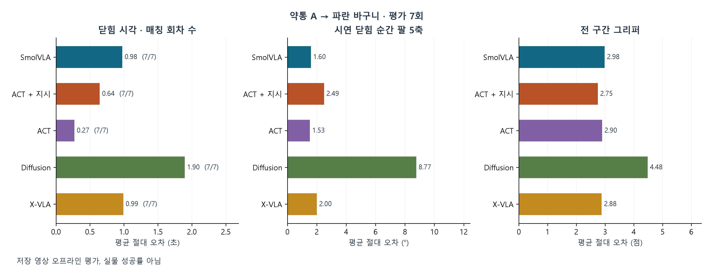
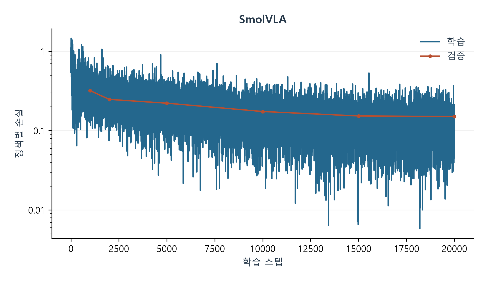
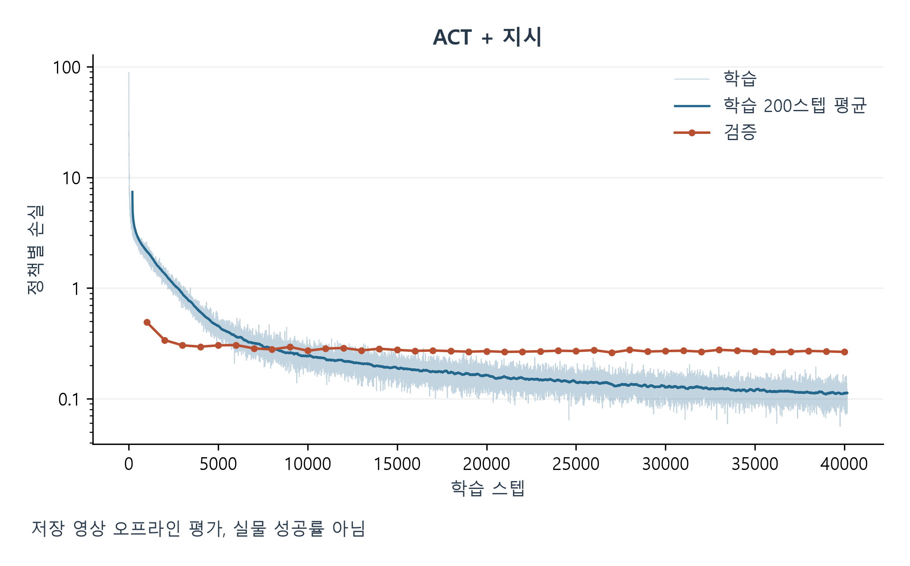
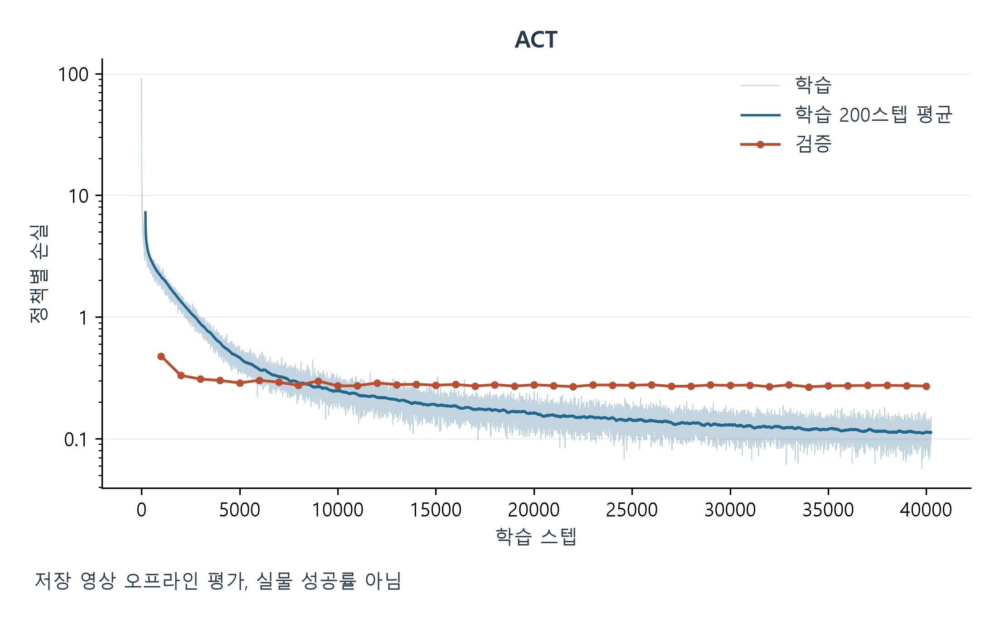
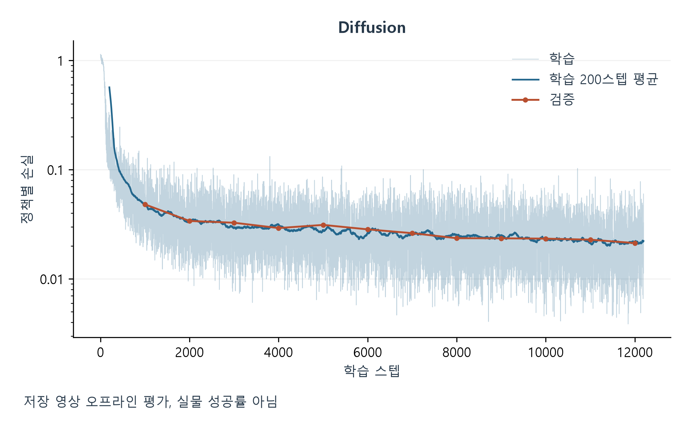
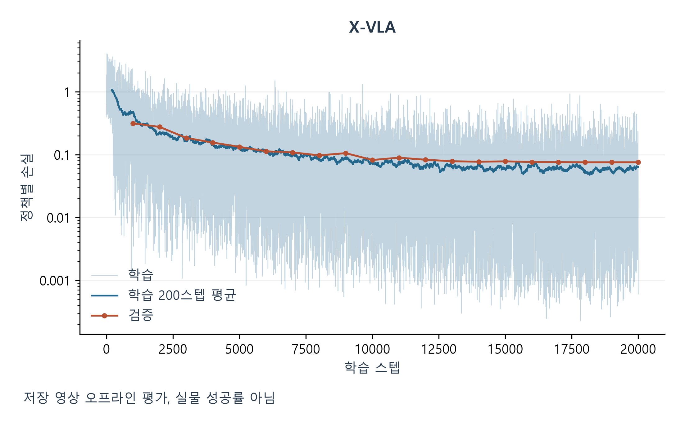
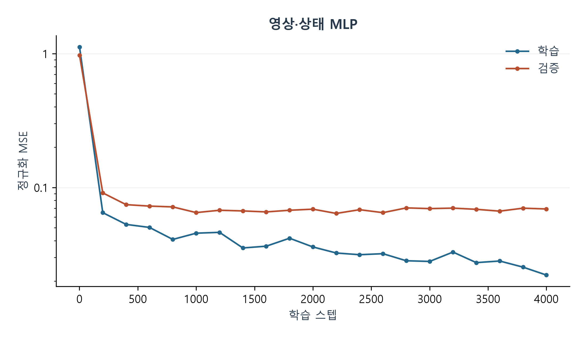
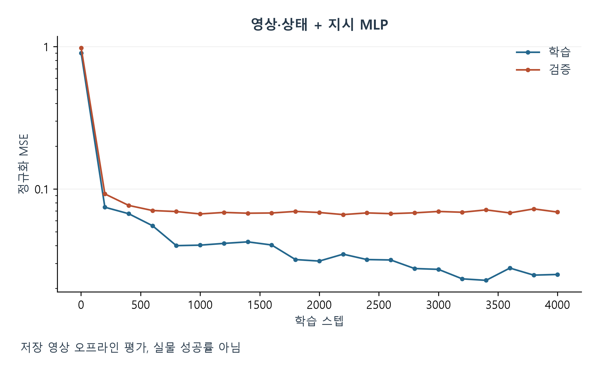

# 약통 A → 파란 바구니 · 마지막 저장 체크포인트 비교

**약통 A → 파란 바구니의 다음 입회 비교 시험 후보는 기본 ACT의 100개 행동 묶음(chunk)이다.** 마지막 체크포인트 40,244에서 파랑 7회의 닫힘 시각 MAE는 0.271초, 닫힘 순간 팔 자세 MAE는 1.533°로 새 모델 5종 중 가장 낮았다. 그리퍼 MAE는 2.898점이며 최저인 ACT + 지시(2.749점)와 0.149점 차이다. 파랑 방향은 다섯 모델 모두 7/7이었다. 기본 ACT에는 색 지시 입력이 없으므로 이 추천은 약통과 파란 바구니의 배치를 고정한 단일 작업에 한정한다.

기본 ACT chunk는 Jetson에서 180초 동안 고유 행동 15.01개/초와 누적 대기 0초를 기록했다. 같은 시스템 부하와 입력 주기라면 예상 대기는 약 0초다. 기존 배포 SmolVLA 역시 같은 시험의 대기가 0초였다. ACT의 장점은 짧은 묶음 추론과 시연 닫힘 재현에 있다. 현장 투입 근거는 배포본에만 있고, 새 ACT의 실물 파지·투입은 미측정이므로 운영 모델의 교체 근거는 아직 확보되지 않았다. [실물 투입 3건의 영상 판독](EVIDENCE_AUDIT.md)

파랑 7회 중 기본 ACT는 6회에서 시연보다 먼저 닫힘을 예측했다. 가장 빨랐던 136번 회차에서는 0.667초 빨랐고 닫힘 순간 팔 5축 오차도 3.62°였다. 입회 시험에서는 약통이 손가락 안에 들어온 뒤 닫히는지 먼저 확인할 필요가 있다. [회차별 닫힘 시각과 축별 오차](act/metrics_blue.json)

배포 SmolVLA와 기본 ACT를 같은 파랑 7회에서 재생했을 때, 닫힘 시각 오차는 각각 0.852초와 0.271초, 닫힘 자세 오차는 1.020°와 1.533°, 그리퍼 오차는 2.495점과 2.898점이었다. 배포본은 이 7회를 학습했고, 기본 ACT에서는 7회 모두 학습에서 제외했다. 현장에서 어느 모델이 더 자주 투입에 성공하는지는 아직 비교하지 않았다.

## 파랑 7회 집기 지표

동일한 시연 7회·3,163프레임을 재생했다. 아래 닫힘 시각과 자세는 회차 평균, 팔과 그리퍼의 전 구간 MAE는 프레임 가중 평균이다. 매칭은 시연과 예측 모두에서 닫힘을 검출한 회차 수다.

| 모델 | 닫힘 시각 MAE (초) | 매칭 | 닫힘 자세 5축 MAE (°) | 그리퍼 MAE (점) | 전 구간 팔 5축 MAE (°) | 바구니 방향 일치 |
| --- | --- | --- | --- | --- | --- | --- |
| SmolVLA | 0.976 | 7/7 | 1.596 | 2.984 | 2.568 | 7/7 |
| ACT + 바구니 지시 | 0.643 | 7/7 | 2.494 | 2.749 | 2.803 | 7/7 |
| 기본 ACT | 0.271 | 7/7 | 1.533 | 2.898 | 2.800 | 7/7 |
| Diffusion | 1.895 | 7/7 | 8.766 | 4.481 | 5.353 | 7/7 |
| X-VLA | 0.990 | 7/7 | 2.001 | 2.881 | 2.650 | 7/7 |
| 배포 SmolVLA¹ | 0.852 | 7/7 | 1.020 | 2.495 | 2.066 | 7/7 |
| 영상·상태 MLP² | 1.024 | 7/7 | 2.113 | 3.257 | 2.970 | 7/7 |
| 지시 MLP² | 0.890 | 7/7 | 1.974 | 3.011 | 3.306 | 7/7 |

¹ 배포 가중치 `b84b15c7…`는 137회를 모두 학습했다. 이 행은 학습 데이터 재현 참고치다. ² 두 MLP는 최소 기준선이다.

## 전체 21회 집기 지표

빨강·초록·파랑 각 7회, 총 9,842프레임이다. 파랑 7회는 이 집계에도 포함된다.

| 모델 | 닫힘 시각 MAE (초) | 매칭 | 닫힘 자세 5축 MAE (°) | 그리퍼 MAE (점) | 전 구간 팔 5축 MAE (°) | 바구니 방향 일치 |
| --- | --- | --- | --- | --- | --- | --- |
| SmolVLA | 0.902 | 21/21 | 1.266 | 3.084 | 2.456 | 21/21 |
| ACT + 바구니 지시 | 0.830 | 21/21 | 2.170 | 3.315 | 2.661 | 21/21 |
| 기본 ACT | 0.543 | 21/21 | 1.519 | 3.396 | 2.658 | 21/21 |
| Diffusion | 1.860 | 21/21 | 5.267 | 4.809 | 5.194 | 20/21 |
| X-VLA | 0.606 | 21/21 | 1.465 | 3.114 | 2.570 | 21/21 |
| 배포 SmolVLA¹ | 0.456 | 21/21 | 0.987 | 2.426 | 1.921 | 21/21 |
| 영상·상태 MLP² | 0.733 | 21/21 | 2.005 | 3.781 | 2.795 | 21/21 |
| 지시 MLP² | 0.790 | 21/21 | 1.900 | 3.484 | 2.885 | 21/21 |

### 시연 닫힘 순간의 관절별 자세 오차

각 칸은 **파랑 7회 / 전체 21회** 평균 절대 오차(°)다. 공통 시연 프레임에서 비교한 다섯 관절을 각각 표시한다.

| 모델 | 어깨 회전 | 어깨 들기 | 팔꿈치 | 손목 굽힘 | 손목 회전 |
| --- | --- | --- | --- | --- | --- |
| SmolVLA | 0.49 / 0.62 | 3.71 / 2.22 | 2.74 / 2.23 | 0.84 / 0.99 | 0.20 / 0.27 |
| ACT + 바구니 지시 | 0.54 / 0.72 | 4.80 / 3.91 | 4.36 / 3.65 | 2.12 / 1.92 | 0.66 / 0.65 |
| 기본 ACT | 0.73 / 0.82 | 2.46 / 2.50 | 2.06 / 2.34 | 1.95 / 1.47 | 0.47 / 0.46 |
| Diffusion | 1.55 / 1.38 | 16.86 / 9.19 | 20.28 / 11.09 | 3.87 / 3.34 | 1.27 / 1.34 |
| X-VLA | 0.44 / 0.53 | 3.76 / 2.30 | 3.32 / 2.28 | 2.07 / 1.76 | 0.41 / 0.45 |
| 배포 SmolVLA¹ | 0.42 / 0.56 | 1.87 / 1.69 | 2.21 / 1.82 | 0.32 / 0.55 | 0.28 / 0.33 |
| 영상·상태 MLP² | 0.77 / 1.00 | 3.76 / 3.37 | 3.34 / 3.13 | 2.07 / 1.96 | 0.63 / 0.56 |
| 지시 MLP² | 0.58 / 0.87 | 4.28 / 3.80 | 2.28 / 2.52 | 2.15 / 1.86 | 0.59 / 0.45 |

## 체크포인트 선택과 학습 조건

검증 loss 순위를 사용하지 않고, 학습 상태와 가중치 파일이 온전히 저장된 마지막 번호를 선택했다. 공식 모델은 RTX 3060 한 대에서 seed 101로 학습했다. 학습 116회(빨강 41·초록 38·파랑 37)와 평가 21회를 회차 단위로 분리했다. 분할은 촬영 세션 단위가 아니어서 일부 촬영 배치와 구도를 공유한다. [고정 분할](split.json) · [시간 한도와 종료 로그](STATUS.md)

| 모델 | 파라미터 | 배치 | 저장 / 목표 스텝 | 큐 사용 시간¹ | 종료 사유 | 가중치 SHA-256 앞 12자리 |
| --- | --- | --- | --- | --- | --- | --- |
| SmolVLA | 450,046,176 | 4 | 20,000 / 20,000 | 3시간 07분 | 목표 달성 | 765908e3ccb3 |
| ACT + 바구니 지시 | 51,600,262 | 8 | 40,163 / 100,000 | 약 8시간 | 8시간 한도 | e73bd6c25b9d |
| 기본 ACT | 51,597,190 | 8 | 40,244 / 100,000 | 7시간 58분 | 8시간 한도 | 9d15fc76c78d |
| Diffusion | 292,686,950 | 8 | 12,194 / 100,000 | 7시간 58분 | 8시간 한도 · 학습 부족 가능 | 62dd30637301 |
| X-VLA | 879,482,456 | 1 | 20,000 / 20,000 | 6시간 06분 | 목표 달성 | 04a7aac7749f |

¹ 시간에는 탐색·검증·저장 및 복구에 사용한 큐 시간이 포함된다. ACT + 지시의 시간은 최종 저장 시각과 큐 예산으로 확인한 근삿값이다. 두 MLP는 4,000/4,000스텝으로 종료했다. 배포 SmolVLA의 마지막 3색 학습은 별도 20,000스텝이다. [배포 모델의 학습 기록](../model_figures/SUMMARY.md)

## 닫힘 순간의 손목 영상 가로 위치

640×480 원본 손목 영상에서 약통 뚜껑의 ArUco ID 9 네 꼭짓점의 평균 x를 구했다. 시연 닫힘과 **모델이 닫힘을 예측한 시각**의 녹화 프레임을 짝지어 x 차이를 계산했다. 부호가 양수면 후자의 약통이 화면 오른쪽에 있다. 두 시각에서 모두 같은 마커가 보인 회차만 포함했다. [회차별 프레임·좌표·검출 분모](wrist_close_pixels.json)

| 모델 | 파랑 절대차 (px) | 평균 Δx (px) | 검출 쌍 | 전체 절대차 (px) | 평균 Δx (px) | 검출 쌍 |
| --- | --- | --- | --- | --- | --- | --- |
| SmolVLA | 4.6 | 0.6 | 6/7 | 14.3 | -5.7 | 19/21 |
| ACT + 바구니 지시 | 5.7 | 5.7 | 6/7 | 6.5 | 4.8 | 18/21 |
| 기본 ACT | 4.2 | 1.6 | 7/7 | 8.8 | 1.9 | 20/21 |
| Diffusion | 5.9 | -1.4 | 4/7 | 12.9 | -7.3 | 14/21 |
| X-VLA | 3.4 | 1.2 | 6/7 | 6.0 | 2.3 | 19/21 |
| 배포 SmolVLA¹ | 3.0 | 2.8 | 6/7 | 6.8 | -1.5 | 20/21 |
| 영상·상태 MLP² | 4.7 | 2.4 | 5/7 | 6.3 | -0.7 | 18/21 |
| 지시 MLP² | 4.5 | 2.2 | 6/7 | 6.2 | -0.1 | 18/21 |

## 지표를 읽는 방법

각 회차의 저장 관측은 손목·천장·사선 RGB와 관절 상태다. 예측 행동을 학습 통계로 역정규화하고 시연 행동과 대조했다. 다섯 최종 모델 모두 16프레임씩 평가했고 마지막 창은 회차 끝에서 잘랐다. 닫힘 시각은 30fps 시연 시간 기준이며 Jetson 실행에서만 0.5배속을 적용했다. 기본 ACT와 Diffusion은 자연어를 받지 않으며, ACT + 지시는 3색 one-hot을 6축 상태에 추가한다.

닫힘은 열림 피크 이후 그리퍼 감소가 3프레임 지속되는 첫 시점으로 검출한다. 시각 오차는 예측·시연 닫힘 프레임 차이의 절댓값을 30으로 나눈 값이다. 자세 오차는 **시연이 닫힌 프레임**에서 예측과 시연 간 팔 5축 절대 차이를 평균한 값이다. 방향은 시연 투입 직전 1초의 예측 팔 궤적과 가장 가까운 학습 궤적의 색으로 판정한다. [산식과 검출 규칙](../../lerobot_training/model_compare/metrics.py)

위 픽셀값은 동일 시연에서 닫힘 타이밍이 달라질 때 보이는 장면 변화를 나타낸다. 예측 행동을 실제로 실행했을 때의 그리퍼–약통 좌우 오차는 미측정이다. 다른 예측 자세에 약통과 손가락을 투영할 검증된 보정·3차원 대응점이 없다. 마커가 가려져 빠진 회차와 검출률 차이를 고려해야 한다.

회차 97은 파랑 평가 ID 중 최솟값으로 선정했다. 그림의 기록 닫힘은 시연 행동으로 검출한 시점이다.

## Jetson 지연과 180초 모의 실행

Jetson Orin에서 동결된 3대 카메라 RGB를 사용해 CPU 전처리, 모델 추론, CPU 행동 반환을 계측했다. 입력은 미리 디코딩했다. 센서 촬영과 동영상 디코딩 시간은 제외했다. 모의 실행은 30 Hz 제어·0.5배속(목표 15개 고유 행동/초)에서 측정했다. 대기는 READY 후 빈 행동 버퍼를 기다린 누적 시간이다.

| 모델·실행 | 행동/묶음 | 평균 / p95 (ms) | GPU 할당 / 예약 (MiB) | RSS 피크 (MiB) | 고유 행동/초 | 180초 대기 합계 (초) |
|---|---:|---:|---:|---:|---:|---:|
| SmolVLA | 50 | 1,364.96 / 1,380.43 | 1,214 / 1,288 | 3,758 | 15.006 | 0.000 |
| ACT + 지시 | 100 | 176.81 / 181.67 | 285 / 374 | 1,766 | 15.006 | 0.000 |
| ACT + 지시 · temporal | 1 | 176.80 / 180.92 | 285 / 374 | 1,766 | 3.733 | 113.419 |
| 기본 ACT | 100 | 175.93 / 178.42 | 285 / 374 | 1,774 | 15.006 | 0.000 |
| 기본 ACT · temporal | 1 | 175.40 / 178.05 | 285 / 374 | 1,774 | 3.733 | 113.403 |
| Diffusion | 32 | 14,956.71 / 14,967.96 | 1,255 / 1,430 | 4,305 | — | — |
| X-VLA | 30 | 785.54 / 790.53 | 1,800 / 1,884 | 4,934 | 15.006 | 0.000 |
| 배포 SmolVLA¹ | 50 | 1,379.69 / 1,463.17 | 1,216 / 1,298 | 4,566 | 15.006 | 0.000 |
| 기본 MLP² | 16 | 6.43 / 7.11 | 9 / 22 | — | 14.550 | 0.035 |
| 지시 MLP² | 16 | 6.06 / 6.34 | 9 / 22 | — | 14.550 | 0.035 |

GPU 수치는 PyTorch 피크, RSS는 호스트 프로세스의 최대 상주 메모리다. Jetson은 메모리를 공유하므로 서로 더하지 않는다. 고유 행동/초는 실제 모의 출력에 사용한 서로 다른 행동 ID 수를 READY 이후 경과 시간으로 나눴다. [RGB 지연과 메모리 원자료](jetson_final_latency.json) · [180초 실행 원자료](jetson_final_scheduler.json) · [기준선 RGB 지연](jetson_rgb_latency.json)

20,000스텝 SmolVLA와 배포본의 기본 묶음은 50개, ACT의 chunk 묶음은 100개다. 요청한 30 Hz에서 표준 legacy 실행 함수와 메모리 내 모의 I/O를 사용했다. 50개 이외의 모델에는 모의 계측기에만 해당 모델의 유효 묶음 길이를 허용했다. 따라서 특히 기본 ACT의 실물 시험에는 100개 묶음 인터페이스 검증이 선행돼야 한다. 예비 동작·카메라 제어·실제 버스 송신은 수행하지 않았다.

ACT temporal은 계수 0.01로 겹치는 예측을 결합해 매번 행동 1개를 제공한다. 추가로 실행한 독립적인 hold-last 모의 결과는 원자료의 `temporal_adapter`에 구분했다. 표의 1개 행동 모드에는 동일 legacy 함수에서 측정한 값을 사용한다.

작은 모델이 제어 주기 지연을 만났을 때 운영 코드의 50 Hz 폴백이 30 Hz 목표보다 높아지는 경우가 있었다. 이때 180초 전에 전송 횟수 상한에 먼저 닿은 시도는 최종 180초 집계에서 제외한다. 모의 환경에서만 폴백을 30 Hz 이하로 제한하고 재실행했다. 재시도와 기기별 호환 설정은 [시험 코드](../../lerobot_training/model_compare/jetson_final_latency.py)에서 확인할 수 있다.

본 비교의 지연 실험에는 시연이 닫히기 직전 프레임과 닫힘 프레임을 준비해 각 정책이 요구하는 관측 길이(1~2프레임)만 사용했다. 평가 21회의 입력을 순회하면서 모델별 예열 10회 뒤 42회를 측정했다. MLP의 기존 지연 기록은 40회 예열 뒤 400회 측정한 값이다. 180초 모의 실행은 파랑 7회의 입력을 순환시켰다.

Diffusion은 32개 행동을 정상 반환했으나 첫 추론이 legacy의 9초 제한을 초과했다. READY 전 모의 목표 전송은 0회였다. X-VLA는 학습 버전의 정책 소스를 격리해 최종 가중치 전체를 엄격하게 로드하고 6축 역정규화 순서를 검증했다. 새 SmolVLA도 저장된 토크나이저와 가중치 전체를 로드했다.

**180초 실행에 도달하지 못한 구성**

- **Diffusion** · HOLD · 9.003초 후 중단 · 원문 `정책 추론 응답 시간 초과`.

## 지시 교체 참고 시험

| 모델 | 교체 지시 방향 일치 | 빨강·초록 장면에 파랑 지시 |
| --- | --- | --- |
| SmolVLA | 12/42 | 0/14 |
| ACT + 바구니 지시 | 13/42 | 0/14 |
| X-VLA | 2/42 | 0/14 |
| 배포 SmolVLA¹ | 11/42 | 0/14 |

한 장면에서 상태와 RGB를 고정하고 원래 색 외 두 색으로 지시를 바꿨다. 원래부터 파랑인 7회의 방향 일치와 분모가 다르다. 기준선 지시 MLP는 기존 시험에서 1/42였다. [기준선 시험](prompt_check.json)

## 모델별 학습·검증 곡선

각 그래프에는 한 정책의 목적함수만 표시했다. 모델 간 loss 수치를 직접 비교하지 않는다. 시간 한도로 저장한 모델의 마지막 정기 검증 스텝과 최종 체크포인트는 다를 수 있다. 위 비교표는 마지막 체크포인트로 별도 추론한 결과다.

## 실물 증거와 한계

배포 SmolVLA의 파란 바구니 투입 장면 3건은 모두 legacy 0.4배속 기록이다. 실행 중 사람이 약통을 다시 놓은 15:30 건을 제외하고 14:40·15:54 두 건을 채택했다. 14:40 기록은 들기 직전 약 3초 영상 공백이 있다. 이 세 사례는 사후 선정되어 성공률 분모가 없다. [실행별 영상·모델·명령 근거](EVIDENCE_AUDIT.md)

각 모델은 seed 1개이고 파랑은 7회이므로 단일 회차가 방향 일치율을 약 14.3%p 바꾼다. 오프라인 평가는 모델이 선택한 행동으로 다음 카메라 영상이 달라지는 폐루프 오차, 접촉, 미끄러짐을 측정할 수 없다. 새 후보들의 실제 파지·투입 성공률은 미측정이다.

## 원자료와 재현

모델별 JSON에 마지막 체크포인트 SHA-256, 평가 회차 목록, 방향·닫힘 검출 결과 및 관절별 오차가 있다. 같은 이름의 `train_metrics.csv`에는 스텝별 loss·lr·grad_norm, `validation_metrics.csv`에는 정기 검증 수치가 있다.

[SmolVLA](smolvla/metrics.json) · [ACT + 바구니 지시](act_task/metrics.json) · [기본 ACT](act/metrics.json) · [Diffusion](diffusion/metrics.json) · [X-VLA](xvla/metrics.json) · [배포 SmolVLA¹](historical_smolvla/metrics.json)

[기본 MLP](rgb_mlp_color_metrics.json) · [지시 MLP](rgb_mlp_task_color_metrics.json) · [학습 큐](../../lerobot_training/model_compare/train_queue.py) · [평가기](../../lerobot_training/model_compare/evaluate.py) · [최종 그림 생성기](../../lerobot_training/model_compare/final_figures.py)

평가기를 같은 학습 환경에서 `evaluate.py MODEL DATASET RUNS OUTPUT --step STEP`으로 호출한다. 데이터 경로는 ACT + 지시에 9개 상태값의 one-hot 분할을, 다른 모델에 6개 상태값의 표준 분할을 지정한다. 기본 ACT와 Diffusion에는 `--skip-prompt-check`, X-VLA에는 `--xvla-native`를 사용한다. 기존 배포본은 Jetson에서 배포 설정의 FP16 자동 혼합 정밀도로 626개 창을 재생했다. [배포본 재생 기록](historical_smolvla/gpu_replay_provenance.json) · 배포 가중치는 배포 환경의 [저장 영상 재생기](../../lerobot_training/model_compare/historical_full.py)로 별도 계산했다. 손목 좌표에 사용한 마커 사전과 프레임 선택 규칙은 [손목 영상 분석기](../../lerobot_training/model_compare/wrist_close_pixels.py)에 있다.

이전 진행 보고와 당시 기준선 측정의 전문은 [학습 종료 시점 보고서](https://github.com/Phjrab/mediflow-robotics/blob/f67a27a/reports/model_compare/COMPARE.md)에 보존돼 있다.
