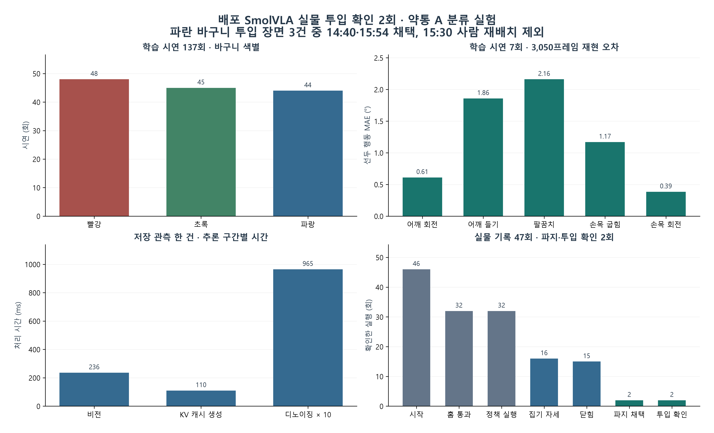

# 약통 A 분류 모델 학습·성능 보고

2026-11-22 · SmolVLA 3색 최종 모델 · 저장 자료 분석과 오프라인 GPU 재추론 · 로봇 쓰기 0회

학습에 사용된 7회에서 첫 행동의 팔꿈치 오차는 2.16°, 그리퍼 오차는 1.54점이었다. 별개로 11월 20일의 실제 VLA 투입을 세 실행에서 영상으로 확인했다. 같은 조건의 독립 반복 성공률은 기록 없음.

## 핵심 수치

[성공 실행별 관절·그리퍼 그래프와 사선 타임라인](success_runs/README.md)에서 세 투입의 근거를 볼 수 있다. 15:30 실행은 첫 낙하 뒤 사람이 약통을 재배치했다. 세 건은 최종 집기·투입 장면을 확인한 횟수이며, 실행 전체에서 사람 개입이 없었던 횟수는 따로 검증해야 한다.

| 지표 | 값 | 분모·조건 |
|---|---|---|
| 최종 train loss / 최저 train loss | 기록 없음 / 기록 없음 | 최종 3색 run의 스텝별 로그 미확보 |
| val loss | 기록 없음 | 137회 모두 train, 독립 검증셋 미분리 |
| 학습 스텝 | 빨강·초록 20,000 → 최종 3색 20,000 | 별도 run, 2차는 1차 가중치에서 시작 |
| 학습 시간 / GPU | 기록 없음 / RTX 3060 | 장치는 인계기록, 학습 경과 시간 원본 미확보 |
| 추론 중앙값 / p95 | 1,442.8 / 1,508.3 ms | 저장 영상 180초 실행, prime 포함 58회 |
| 제어 루프 / 고유 행동 소비 | 29.99 Hz / 16.09 actions/s | 저장 영상·모의 팔 180초 |
| 실제 목표 전송 | 44.25 Hz | 0.5배속 · 20261119_210316 |
| 실물 투입 확인 | 최소 3 / 47회 | 여러 설정과 짧은 시험을 포함한 기록에서 확인한 하한 |

### 관절별 선두 행동 MAE

| 축 | 단위 | 기존 7회 전체 3,050프레임 | 동일 회차 재추론 42프레임 | 다른 7회 새 추론 112프레임 | 기존 닫힘 전후 0.5초 | 기존 나머지 구간 |
|---|---|---|---|---|---|---|
| 어깨 회전 | ° | 0.611 | 0.366 | 0.650 | 0.503 | 0.620 |
| 어깨 들기 | ° | 1.859 | 0.893 | 1.686 | 1.471 | 1.889 |
| 팔꿈치 | ° | 2.161 | 0.940 | 1.812 | 1.924 | 2.180 |
| 손목 굽힘 | ° | 1.170 | 0.489 | 1.275 | 1.124 | 1.174 |
| 손목 회전 | ° | 0.385 | 0.196 | 0.552 | 0.327 | 0.390 |
| 그리퍼 | 점 | 1.539 | 2.695 | 1.876 | 2.376 | 1.475 |

### 실물 단계 도달률

| 단계 | 앞 단계까지 확인 / 전체 | 누적 증거 비율 | 홈 기록 누락과 무관한 해당 단계의 확인 수 |
|---|---|---|---|
| 실행 시작 | 46/47 | 97.9% | 46/47 |
| 홈 통과 | 32/47 | 68.1% | 32/47 |
| 정책 실행 | 32/47 | 68.1% | 40/47 |
| 집기 자세 | 16/47 | 34.0% | 16/47 |
| 그리퍼 닫힘 | 15/47 | 31.9% | 15/47 |
| 파지 성공 | 3/47 | 6.4% | 3/47 |
| 바구니 투입 | 3/47 | 6.4% | 3/47 |

구형 실행은 홈 기록 형식이 달라 정책 전송 증거가 있어도 홈을 확인할 수 없는 경우가 있다. 누적 열은 이전 단계의 증거를 모두 요구한다. 개별 열은 해당 단계의 증거만 센다. 파지·투입 수치는 영상으로 확인된 하한이다.

## 자료 위치와 모델 계보

최종 가중치 SHA-256은 `b84b15c70ee711ce3ec5780e8498073852f28c43ccc6a726e9196761d05a7654`이다. 로컬 배포 파일과 Jetson에서 재추론에 사용한 파일을 각각 읽어 확인했다. 2차 작업명은 `a_red_green_blue_exclude10_production`, 학습 PC 상대 경로는 `work/three_color_20261103/run_137_v1/production_b4`다. 같은 폴더의 `train_config.json`은 `work/red_green_20261103/run_v1/production_b4/checkpoints/020000/pretrained_model`을 초기 가중치로 지정한다.

| 찾은 자료 | 위치 또는 결과 |
|---|---|
| TR | `docs/smolvla` (운영 저장소) |
| CK | `.local/models/smolvla_three_color_020000_20261104/pretrained_model` (작업공간, 최종 모델 배포본) |
| MF01 | `MediFlow_coord_20261119/tasks/MF-01` (작업공간) |
| MF03 | `MediFlow_coord_20261119/tasks/MF-03` (작업공간) |
| EVAL | `so101_vla/reports/20261115/GRASP_CAUSE_7_EPISODES/full_frame_evaluation` (작업공간 및 Jetson) |
| RUN | `so101_vla/runs` (Jetson 보존 실행 색인) |
| GR | `MediFlow_coord_20261119/live_210316/grasp` (작업공간) |
| FRESH | `.local/model_figures_work/fresh.log` (작업공간, 이번 재추론의 42개 행, 에피소드·프레임·예측·정답 수록) |
| NEW | `.local/model_figures_work` (작업공간, additional.log에 다른 7회 112프레임의 추론 결과 수록) |

PNG 하단에 위 경로 별칭과 파일명을 표기했다. 작업공간 또는 Jetson 자료는 해당 환경의 상대 경로다. 원본 영상·가중치·원문 시리얼 로그는 공개 묶음에서 제외했다.

### 학습 로그와 체크포인트 실사

| 항목 | 기록 또는 설정 |
|---|---|
| W&B / TensorBoard / train.log / training_state | W&B 비활성, run_id 없음. 배포 ZIP, 작업공간, 확보한 보관 브랜치·현장 보존 자료에서 이 최종 run의 학습 로그·이벤트·옵티마이저 상태를 확보하지 못함. |
| 스텝별 실제 loss / lr / grad_norm / step 시간 | 모두 기록 없음. log_freq=50은 기록 간격 설정이다. |
| 학습 설정 | batch 4, seed 101, AdamW · peak lr 0.0001, decay lr 0.0000025, warmup 1,000, cosine decay 30,000, grad_clip_norm 10.0. 이 숫자는 측정 이력이 아닌 설정이다. |
| 검증 지표 | eval_steps=0, env_eval_freq=0, 검증·테스트 매니페스트 모두 0회. |
| 실제 확인한 최종 run 체크포인트 | 020000의 pretrained_model 7개 파일. 005000 / 010000 / 015000은 save_freq=5,000에서 예상되는 저장 시점이며 실파일 기록 없음. |
| 체크포인트별 오차 / 과적합 | 최종본 1개에서만 추론 가능. 별도 검증셋과 중간본이 없어 추세를 판정할 수 없음. |

## 그래프

### 1. [학습 데이터] 사람의 시연에서 3색 SmolVLA까지

![[학습 데이터] 사람의 시연에서 3색 SmolVLA까지](01_training.png)

3색 학습은 빨강·초록 가중치를 이어받은 별도 실행이다.

원본: `TR/TRAINING_SUMMARY_20261104.md` · `CK/train_config.json`

### 2. [학습 데이터] 바구니별 시연과 회차 길이

![[학습 데이터] 바구니별 시연과 회차 길이](02_dataset.png)

137회, 63,551프레임, 30 fps. 회차 길이 중앙값은 467프레임이다.

원본: `MF01/COMMON_TRAIN_ONLY_MANIFEST.json` · `TR/TRAINING_SUMMARY_20261104.md`

빨강 48회, 초록 45회, 파랑 44회. 원본 150회 중 13회 제외. 회차 길이 46–664프레임. 640×480 RGB 30 fps, camera1 손목 USB, camera2 천장 수직 Astra, camera3 천장 사선 RealSense. 6축은 팔 5관절과 그리퍼다.

### 3. [학습 데이터] 학습 지표의 기록 범위

![[학습 데이터] 학습 지표의 기록 범위](03_learning_records.png)

최종 설정은 확인했으며, 스텝별 관측값이 없어 손실 감소나 과적합 추세를 판정할 수 없다.

원본: `CK/train_config.json` · `smolvla_three_color_020000.zip (배포본)`

### 4. [학습 데이터] 기존 7회와 다른 7회의 학습 데이터 재현 오차

![[학습 데이터] 기존 7회와 다른 7회의 학습 데이터 재현 오차](04_mae.png)

기존 3,050프레임의 팔꿈치 MAE는 2.16°, 다른 7회에서 새로 추론한 112프레임은 1.81°다.

원본: `EVAL/episode_*_actions.npz` · `NEW/additional.log`

| 새 추론 시연 ID | 색 | 표본 수 | 팔꿈치 MAE (°) | 그리퍼 MAE (점) |
|---|---|---|---|---|
| 11 | red | 16 | 1.766 | 2.320 |
| 36 | red | 16 | 1.854 | 2.833 |
| 59 | green | 16 | 1.843 | 0.487 |
| 82 | green | 16 | 1.665 | 2.410 |
| 100 | blue | 16 | 1.506 | 1.458 |
| 114 | blue | 16 | 2.599 | 2.005 |
| 129 | blue | 16 | 1.448 | 1.619 |

새 비교군도 학습에 사용된 회차다. 기존 7회를 제외한 색별 회차 목록의 균등 구간 중점에서 빨강 2회·초록 2회·파랑 3회를 선택했다. 선택 ID는 11, 36, 59, 82, 100, 114, 129다. 각 회차의 시간을 8등분하여 각 중점 근처 연속 2프레임씩, 총 112프레임을 동일 체크포인트와 시드 규칙으로 추론했다. 표본 구성과 색 비율이 달라 오차 차이를 모델 개선율로 해석할 수 없다. 원본: `NEW/additional.log`.

원본 NPZ의 predictions[:,0,:]와 recorded를 같은 프레임에서 빼고 절댓값의 전체 프레임 평균을 냈다. 7개 회차 평균을 다시 동일 가중으로 평균내지 않았다. 7회 중 파랑 5, 빨강 1, 초록 1이다. 42개 새 입력은 각 회차의 첫 두 프레임, 닫힘 후보가 들어 있는 두 프레임, 끝에 가까운 마지막 짝수 정렬 두 프레임이다. 동일 프레임 seed(100000 × 회차 번호 + 101 + 프레임 번호), 배치 2, CUDA AMP, 10회 denoising, 50행동을 사용했다. 42 × 50 × 6개 출력의 보존 NPZ 대비 최대 절대 차이는 0이었다. 새 표본 MAE와 3,050프레임 MAE의 차이는 표본 구성에 따른다. 원본: `FRESH`, `so101_vla/analysis/grasp_diagnosis.py`.

### 5. [학습 데이터] 회차별 재현 오차의 분포

![[학습 데이터] 회차별 재현 오차의 분포](05_episode_errors.png)

점 하나는 시연 한 회의 MAE다. 박스는 7회 중 가운데 50%의 범위다.

원본: `EVAL/episode_*_actions.npz` · `EVAL/episode_manifest.json`

### 6. [학습 데이터] 파랑 93번 시연의 정답과 예측

![[학습 데이터] 파랑 93번 시연의 정답과 예측](06_trajectory.png)

세로선은 시연 행동에서 찾은 닫힘 후보 181프레임(6.03초)이다.

원본: `EVAL/episode_93_actions.npz` · `EVAL/quality.json`

### 7. [학습 데이터] 닫힘 구간과 나머지 구간의 오차

![[학습 데이터] 닫힘 구간과 나머지 구간의 오차](07_grasp_error.png)

그리퍼 MAE는 닫힘 전후 2.38점, 나머지 1.47점이다. 닫힘 후보는 행동값으로 검출했다.

원본: `EVAL/episode_*_actions.npz` · `EVAL/quality.json`

닫힘 후보 ±15프레임 양끝 포함 217프레임, 나머지 2833프레임. 기존 수치 10.81점은 **각 회차 닫힘 후보 한 프레임씩, 7개 중 그리퍼 최대 오차**(10.814점)다. 3,050프레임 전체 최대 오차나 구간 MAE와 분모가 다르다.

### 8. [검증 데이터] 저장 영상 실행기 시험의 추론 지연

![[검증 데이터] 저장 영상 실행기 시험의 추론 지연](08_latency.png)

별도 프로파일 한 호출에서 디노이징이 약 965 ms로 가장 길었다. 모델의 독립 검증셋은 없다.

원본: `MF03/WALLCLOCK.json` · `MF03/DENOISING.json` · `MF03/DENOISING_STAGES.csv`

전체 180초 자료의 평균 1,445.7 ms. 별도로 동일 장치·체크포인트에서 10회 디노이징 6개 비워밍업 호출 p50 1,379.4 ms, p95 1,406.3 ms. 분해는 별도 1호출의 CUDA 계측으로 비전 236.2 ms, VLM prefix KV 110.4 ms, 디노이징 합 964.9 ms, wall 1372.9 ms. 이 세 구간 외에도 전·후처리 등이 있다. GPU Orin. 별도 계측 원본 입력은 DRY_RAW_1795069654863293501/grasp_1/event.json. [검증 데이터]는 여기서 실행기 검증용 저장 관측을 뜻한다.

### 9. [검증 데이터] 실행기 처리율   /   [실물 live] 버스 제어 주파수

![[검증 데이터] 실행기 처리율   /   [실물 live] 버스 제어 주파수](09_runtime.png)

모의 루프, 고유 행동 소비, 실물 버스 전송은 각각 다른 사건을 센다.

원본: `MF03/WALLCLOCK.json` · `RUN/20261119_210316/summary.json`

저장 영상 시험 ID는 `mf03-offline-ii2hd6fe`, raw 1.0배속, 실제 모터 쓰기 0회. 5,398 제어 루프, 2,897개 고유 행동, 묶음 대기 83.66초. 실물 0.5배속은 `20261119_210316`, 목표 전송 7,965개, 묶음 대기 0초. 이 두 조건으로 배속의 인과 효과를 계산할 수 없다.

### 10. [실물 live] 단계별 누적 도달 증거

![[실물 live] 단계별 누적 도달 증거](10_live_funnel.png)

식별된 47회 중 파지·투입을 영상으로 확인한 실행은 최소 3회다. 미판정 실행을 실패로 세지 않았다.

원본: `RUN/*/{RESULT.json,summary.json,steps.jsonl}` · `TR/WORK_LOG.md`

시작 단계는 실행 요약 또는 전송 기록이 있는 경우다. 식별된 47개 중 1개는 빈 실행 파일만 남아 있어 도달 여부 미확인이다. 구형 steps.jsonl의 start 또는 startup_ready에 기록된 home_delta와 이후 정책 실행도 홈 통과 근거에 포함했다.

분모는 Jetson RUN의 11/08–11/20 날짜형 실물 VLA 실행 식별자 47개다. 11/11 15:57의 빈 steps 파일도 시도 흔적으로 포함했다. DRY, 별도 LIVE_EPISODE_REPLAY, PING·READ, 중복 LAUNCH 래퍼는 제외했다. 대응 실행 폴더가 없는 빈 LAUNCH 래퍼는 모드를 확인할 수 없다. 짧은 초기 제한 스텝 시험도 포함했다. 홈은 startup_home_converged 또는 홈 검사 필드가 있는 startup_ready, 정책 실행은 실제 정책 목표 1회 이상 전송을 사용했다. 집기 자세는 선두 5관절의 실측값이 파랑 44회 닫힘 자세의 각 축 5–95백분위에 동시에 들어온 경우다. 그리퍼 닫힘은 그 구간 또는 마지막 도달 후 1초 이내에 직전 1초 내 관측 피크에서 실측 5점 이상 감소한 경우다. 이는 운동학적 대리 지표이며 물체 접촉을 확정하지 않는다. 원본: `GR/training_closures.json`.

영상 판정은 사람 도움 없이 약통 A가 올라가고 파란 바구니 안에 놓인 것이 확인된 실행을 센다. 20261120_144002는 +63.83초 들림, +65.02초 놓임, 153047은 +84.90초 운반, +85.92초 투입, 155459는 +46.7초 들림, +51.0초 투입이다. 140240은 사람 손의 지지 이후 들림·낙하가 있어 자율 파지 성공에 포함하지 않았다. 영상 재생 93번 성공은 별도 시험이다.

### 11. [실물 live] 실행이 끝난 이유

![[실물 live] 실행이 끝난 이유](11_stop_reasons.png)

지정 시간 만료와 짧은 시험 완료를 보호 중단과 나누었다. 종료 사유와 약통 투입 결과는 별도로 기록했다.

원본: `RUN/*/{summary.json,RESULT.json}` · `TR/WORK_LOG.md`

| 종료 사유 | 실행 수 |
|---|---|
| 시간 만료 | 9 |
| 운영자 중단 | 9 |
| 온도 보호 | 8 |
| 통신 | 8 |
| 홈 수렴 | 5 |
| 짧은 시험 완료 | 3 |
| 목표·추종 보호 | 3 |
| 기록 없음 | 1 |
| 그리퍼 과부하 | 1 |

180초 도달 후 RUN_COMPLETE는 시간 만료로 분류했다. 온도값 자체로 중단한 경우와 온도 읽기 통신 예외를 구분했다. 11/16 17:45 ID6 상태 32는 저장된 SDK 대조 결과로 과부하로 분류했다. 성공한 뒤 HOLD 또는 운영자 중단이 기록된 회차도 있다.

## 대표 실패의 닫힘 순간

20261119_210316의 대표 이벤트 3, 피드백으로 검출한 실제 닫힘 READY +94.604초. 차이는 정책 목표 − 실제, 픽셀은 손목 원본 640×480에서 약통 중심 − 두 손가락 중점이다.

| 측정 항목 | 정책 목표 | 보간 후 전송 목표 | 실측 | 목표 − 실측 또는 영상 차이 |
|---|---|---|---|---|
| 어깨 회전 (°) | -4.53 | -4.53 | 0.13 | -4.66 |
| 어깨 들기 (°) | -94.72 | -94.73 | -40.13 | -54.59 |
| 팔꿈치 (°) | 91.39 | 91.38 | 31.34 | +60.05 |
| 손목 굽힘 (°) | 45.41 | 45.41 | 58.86 | -13.45 |
| 손목 회전 (°) | 0.77 | 0.75 | -2.07 | +2.83 |
| 그리퍼 (점) | 3.59 | 3.55 | 31.33 | -27.75 |
| 대표 학습 닫힘 | — | — | — | 오른쪽 7.2 px |
| live 명령 트리거 | — | — | — | 오른쪽 119.0 px |
| live 실측 닫힘 | — | — | — | 오른쪽 190.6 px |

약통이 손가락 중점보다 오른쪽에 있었다. 이 한 회차만으로 높이, 충돌 원인, mm 단위 오차를 정할 수 없다. 원본: `GR/live_closures.json`, `GR/pixel_measurements.json`, `GR/REPORT.md`.

## 발표용 한 장

학습 재현 오차와 실물 결과는 다른 질문에 답한다.

원본: `MF01/COMMON_TRAIN_ONLY_MANIFEST.json`, `EVAL/episode_*_actions.npz`, `MF03/DENOISING_STAGES.csv`, `RUN/*`, `TR/WORK_LOG.md`.

## 한계

- 검증셋 미분리. 137회 전체에 학습했고, 이후 평가한 7회와 새로 재추론한 42프레임도 그 안에 있다. 미관측 배치나 다른 색에 대한 실물 성공률은 기록 없음.
- 확보된 최종 체크포인트에는 스텝별 loss, lr, grad norm과 학습 시간 이력이 없어 원값·이동평균·로그축 train loss를 그리지 않았다. 원 학습 PC에서 동일 run의 로그 및 중간본이 확보되어야 한다.
- 단계별 카운트에는 누락된 과거 로그와 비교가 다른 실행 조건이 있다. 집기 자세는 관절 기반 근사이며 미판정 영상을 실패로 처리하지 않았다. 영상으로 확인된 파지·투입이 있으므로 실물 파지 성공을 0회로 기록할 수 없다.
- [검증 데이터] 실행기 시험은 저장 RGB와 모의 관절을 사용한다. 과거 52.7%는 목표 행동 처리율이며 집기 성공률·개발 완성도가 아니다.

## 실행별 집계 근거

행마다 RUN 아래의 날짜·시각 접두어가 같은 폴더를 사용했다. ○는 직접 기록 또는 명시한 대리 기준의 충족이다. —는 확인 증거가 없는 상태를 포함한다. 파지·투입은 영상 확인 하한이다.

| run | 홈 | 정책 전송 | 자세 | 닫힘 | 파지·투입 영상 | 종료 |
|---|---|---|---|---|---|---|
| 20261108_181123 | — | ○ | — | — | — | 짧은 시험 완료 |
| 20261108_190623 | — | ○ | — | — | — | 목표·추종 보호 |
| 20261108_191603 | — | ○ | — | — | — | 짧은 시험 완료 |
| 20261108_193446 | — | ○ | — | — | — | 짧은 시험 완료 |
| 20261108_195250 | — | ○ | — | — | — | 목표·추종 보호 |
| 20261109_145210 | — | ○ | — | — | — | 목표·추종 보호 |
| 20261109_212833 | ○ | ○ | — | — | — | 온도 보호 |
| 20261109_215013 | — | ○ | — | — | — | 온도 보호 |
| 20261110_191852 | — | ○ | — | — | — | 온도 보호 |
| 20261110_201618 | ○ | ○ | ○ | ○ | — | 통신 |
| 20261111_155718 | — | — | — | — | — | 기록 없음 |
| 20261111_174131 | ○ | ○ | — | — | — | 온도 보호 |
| 20261111_180136 | ○ | ○ | — | — | — | 온도 보호 |
| 20261111_200151 | ○ | ○ | — | — | — | 온도 보호 |
| 20261115_162129 | ○ | ○ | — | — | — | 온도 보호 |
| 20261115_170600 | ○ | ○ | — | — | — | 온도 보호 |
| 20261115_181130 | ○ | ○ | — | — | — | 통신 |
| 20261115_191851 | ○ | ○ | — | — | — | 시간 만료 |
| 20261116_161136 | — | — | — | — | — | 홈 수렴 |
| 20261116_171500 | ○ | ○ | ○ | ○ | — | 시간 만료 |
| 20261116_174520 | ○ | ○ | ○ | ○ | — | 그리퍼 과부하 |
| 20261116_200615 | — | — | — | — | — | 홈 수렴 |
| 20261118_161810 | — | — | — | — | — | 홈 수렴 |
| 20261118_174341 | — | — | — | — | — | 통신 |
| 20261118_181230 | — | — | — | — | — | 홈 수렴 |
| 20261118_181437 | — | — | — | — | — | 홈 수렴 |
| 20261118_184646 | ○ | ○ | ○ | ○ | — | 시간 만료 |
| 20261118_193516 | ○ | ○ | — | — | — | 통신 |
| 20261119_210316 | ○ | ○ | ○ | ○ | — | 시간 만료 |
| 20261119_215325 | ○ | ○ | ○ | ○ | — | 시간 만료 |
| 20261120_140240 | ○ | ○ | ○ | ○ | — | 시간 만료 |
| 20261120_144002 | ○ | ○ | ○ | ○ | ○ | 운영자 중단 |
| 20261120_144343 | ○ | ○ | ○ | ○ | — | 시간 만료 |
| 20261120_150134 | ○ | ○ | ○ | — | — | 운영자 중단 |
| 20261120_150540 | ○ | ○ | — | — | — | 통신 |
| 20261120_150727 | ○ | ○ | — | — | — | 통신 |
| 20261120_153047 | ○ | ○ | ○ | ○ | ○ | 시간 만료 |
| 20261120_154800 | ○ | ○ | ○ | ○ | — | 운영자 중단 |
| 20261120_155459 | ○ | ○ | ○ | ○ | ○ | 통신 |
| 20261120_160419 | ○ | ○ | ○ | ○ | — | 운영자 중단 |
| 20261120_161714 | ○ | ○ | — | — | — | 운영자 중단 |
| 20261120_162116 | ○ | ○ | ○ | ○ | — | 시간 만료 |
| 20261120_162603 | ○ | ○ | — | — | — | 운영자 중단 |
| 20261120_163755 | ○ | ○ | ○ | ○ | — | 운영자 중단 |
| 20261120_164127 | ○ | ○ | — | — | — | 통신 |
| 20261120_164554 | ○ | ○ | — | — | — | 운영자 중단 |
| 20261120_165034 | ○ | ○ | — | — | — | 운영자 중단 |
