# 성공한 VLA 실행 3회

2026-11-20 실물 기록 · 약통 A → 파란 바구니 · 저장 로그와 영상만 사용 · 이번 작업의 모터 쓰기 0회

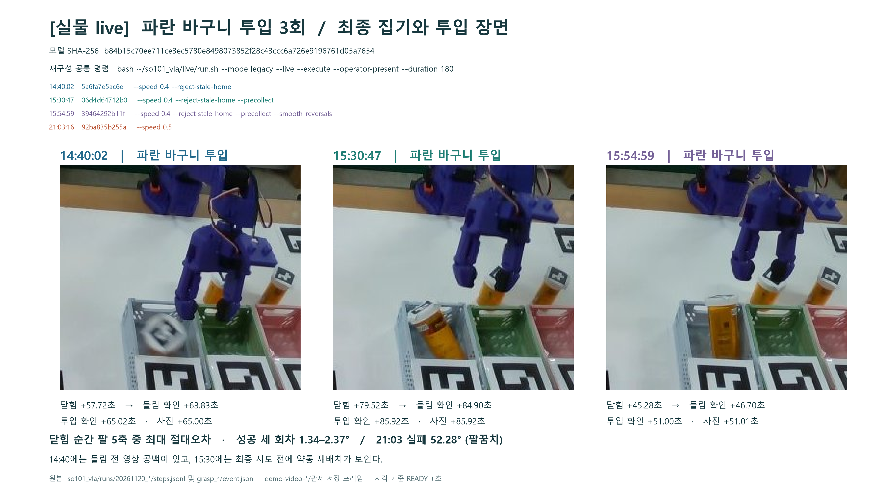

## 식별과 시간 기준

요청에 명시된 이름인 `EVIDENCE_3RUNS`는 접근 가능한 저장소와 현장 보존 자료에서 찾지 못했다. [기존 집계](../SUMMARY.md)와 [영상 판독 기록](../../../docs/smolvla/WORK_LOG.md)의 성공 ID 세 개를 각 실행의 steps.jsonl, summary.json, 사선 카메라 저장본에서 교차 확인했다. 93번 정책 없는 녹화 재생은 포함하지 않았다.

아래 시각은 모두 정책 준비 완료(READY) 이후 초다. 집기 시각에는 최종 성공 시도에서의 그리퍼 닫힘 실측을 썼다. 접촉 센서 기록은 없다. 들림·투입은 장면에서 확인된 시각이며 물체가 정확히 바닥을 떠나거나 패드를 벗어난 최초 시각에는 관측 간격만큼 불확실성이 있다.

| 실행 | 닫힘 실측 | 들림 확인 | 투입 확인 | 전송 샘플 수 |
|---|---|---|---|---|
| 20261120_144002 | 57.717초 | 63.83초 | 65.02초 | 4460 |
| 20261120_153047 | 79.517초 | 84.90초 | 85.92초 | 7906 |
| 20261120_155459 | 45.279초 | 46.70초 | 51.00초 | 3088 |

모델 SHA-256은 `b84b15c70ee711ce3ec5780e8498073852f28c43ccc6a726e9196761d05a7654`이다. 실행기 커밋은 해당 날짜·시각의 Jetson 저장소 HEAD reflog에서 찾았고 당시 커밋의 `live/config.yaml`에서 모델 SHA를 대조했다. 커밋은 당시 HEAD를 식별하며 해당 시점의 미커밋 파일을 소급 검증하지는 못한다. 제목의 명령은 summary.json의 mode, speed, duration_s, motion_options 및 현장 run.sh 형식으로 재구성했다. 사용자가 실제 입력한 셸 문자열은 별도 보존을 확인하지 못했다.

## 20261120_144002

실행기 `5a6fa7e5ac6e94c64482467b0e996e645a7c1fc5`

`bash ~/so101_vla/live/run.sh --mode legacy --live --execute --operator-present --speed 0.4 --duration 180 --reject-stale-home`

60.53–63.83초 영상 공백. 들림은 +63.83초 프레임에서 확인했다.

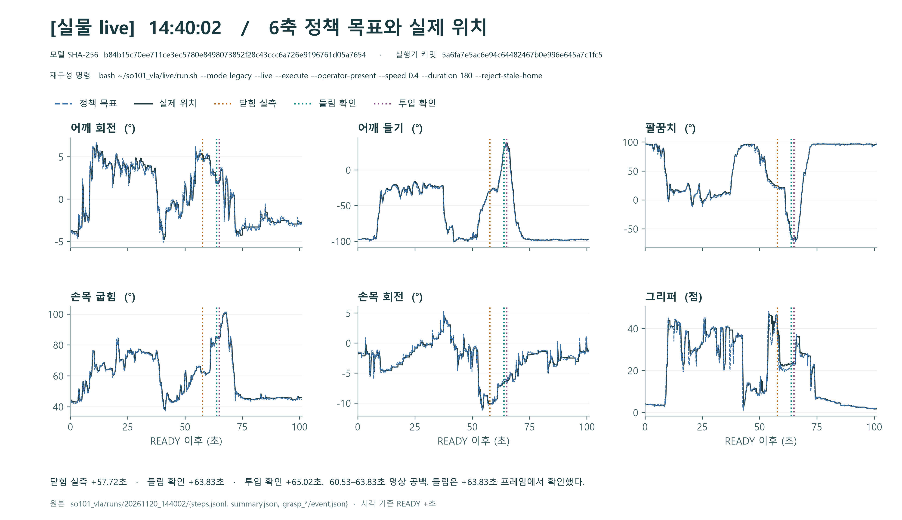

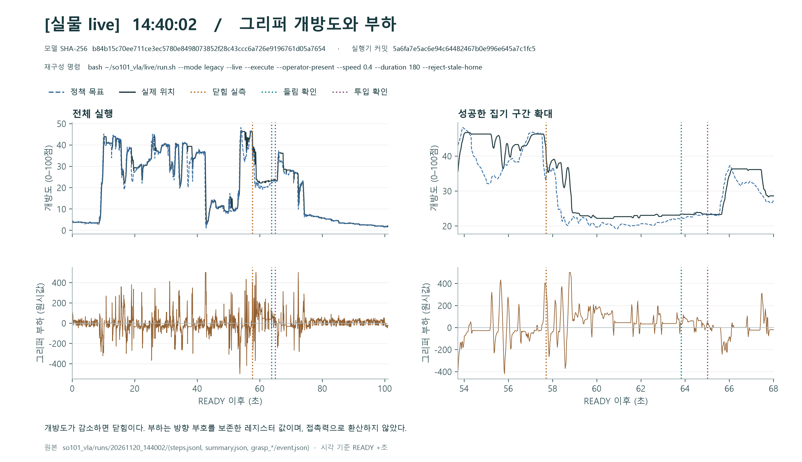

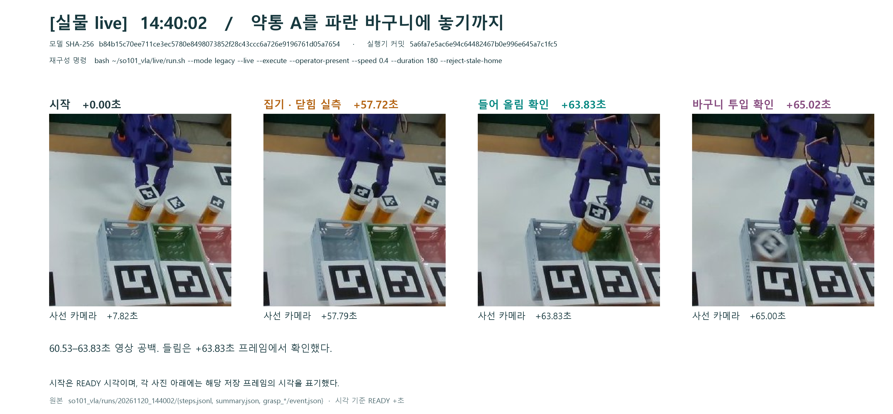

READY 시점 동기 프레임이 없어 시작 칸에 첫 보존 프레임(+7.82초)을 표시했다. +60.53~63.83초 사이의 최초 들림은 영상으로 판독할 수 없다.

사선 썸네일 원본 경로와 프레임 시각

| 단계 | 프레임 (초) | 출처 |
|---|---|---|
| 시작 | 7.824 | `RUN/grasp_1/ceiling_oblique/00000_-002.947.jpg` |
| 닫힘 | 57.791 | `RUN/grasp_25/ceiling_oblique/00049_+001.931.jpg` |
| 들림 | 63.832 | `RUN/grasp_31/ceiling_oblique/00000_-002.918.jpg` |
| 투입 | 64.999 | `RUN/grasp_31/ceiling_oblique/00012_-001.731.jpg` |

## 20261120_153047

실행기 `06d4d64712b07b387f38e2cdd492200c5e86b339`

`bash ~/so101_vla/live/run.sh --mode legacy --live --execute --operator-present --speed 0.4 --duration 180 --reject-stale-home --precollect`

앞선 낙하와 약통 재배치 후, 최종 투입으로 이어진 닫힘을 표시했다.

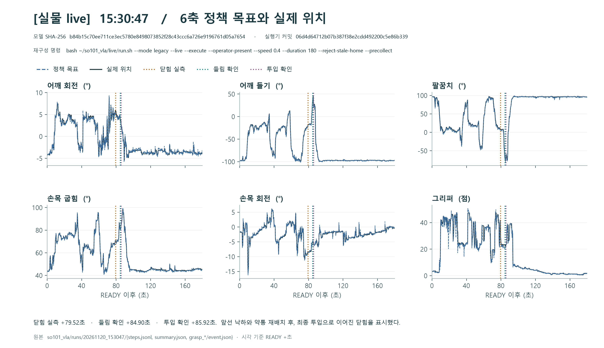

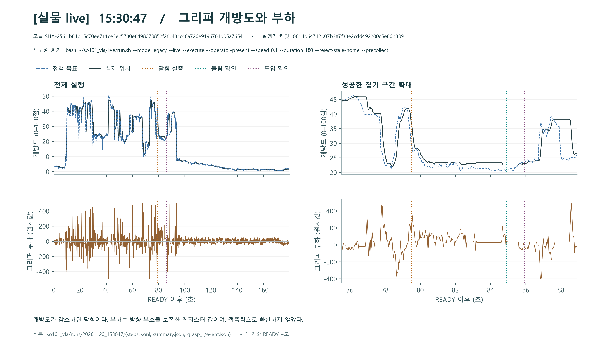

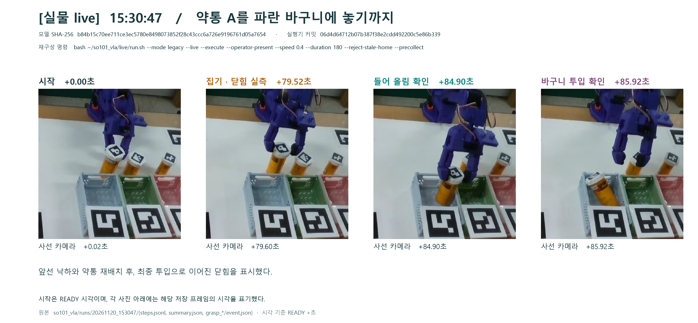

첫 시도는 +32.06초 들림 후 +32.98초 바구니 밖 낙하로 끝났다. +51~60초 사이 사선 기록에 사람이 약통을 만지고 재배치한 모습이 보인다. 최종 집기부터 투입까지를 이 그림에 표시했다.

사선 썸네일 원본 경로와 프레임 시각

| 단계 | 프레임 (초) | 출처 |
|---|---|---|
| 시작 | 0.019 | `mediflow-demo-check-iOcDlKaA/demo-video-F0dvw4R6/1795156311616036704.json` |
| 닫힘 | 79.599 | `RUN/grasp_31/ceiling_oblique/00032_+000.278.jpg` |
| 들림 | 84.902 | `RUN/grasp_32/ceiling_oblique/00007_-002.289.jpg` |
| 투입 | 85.917 | `mediflow-demo-check-iOcDlKaA/demo-video-F0dvw4R6/1795156397570825249.json` |

## 20261120_155459

실행기 `39464292b11fec62f67cc0f4d8067599be9d3c13`

`bash ~/so101_vla/live/run.sh --mode legacy --live --execute --operator-present --speed 0.4 --duration 180 --reject-stale-home --precollect --smooth-reversals`

사선 영상에서 약통이 들린 뒤 바구니 안에 남은 모습을 확인했다.

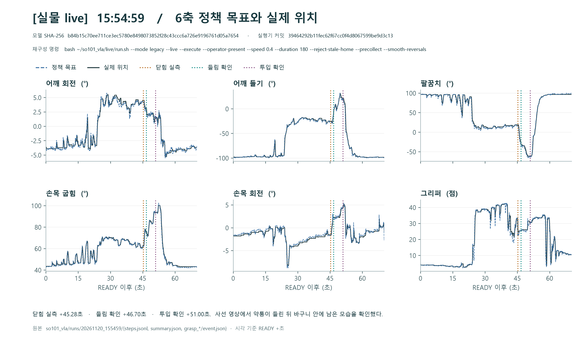

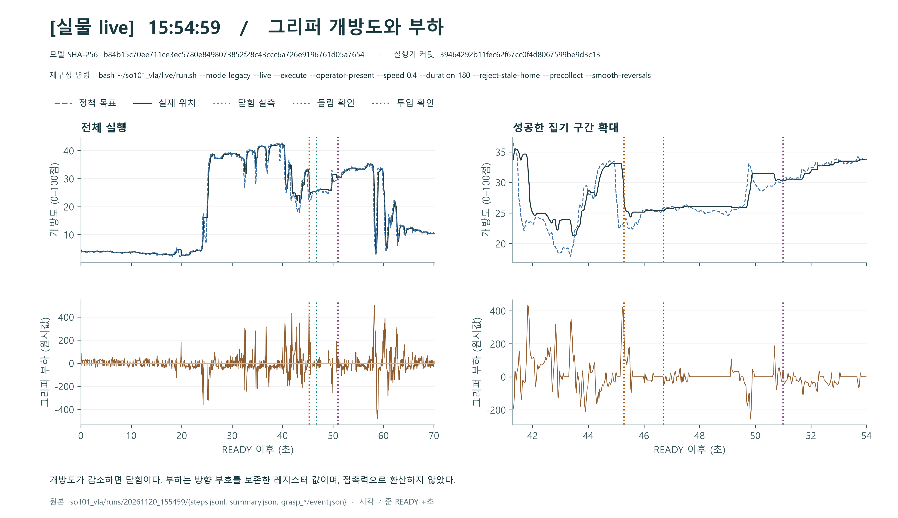

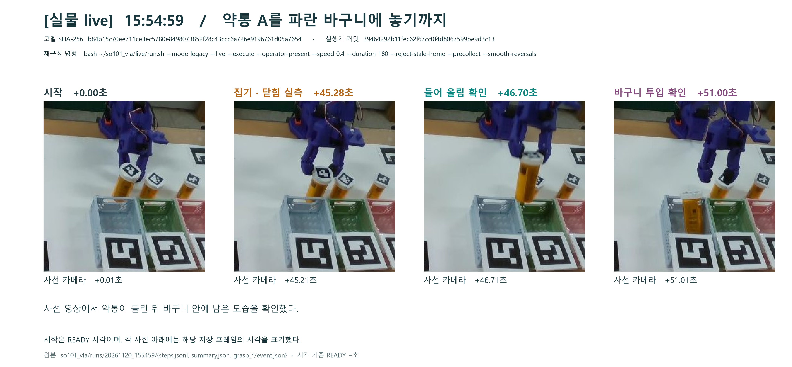

사선 썸네일 원본 경로와 프레임 시각

| 단계 | 프레임 (초) | 출처 |
|---|---|---|
| 시작 | 0.014 | `mediflow-demo-check-iOcDlKaA/demo-video-BR1OOlzY/1795157766184779066.json` |
| 닫힘 | 45.207 | `RUN/grasp_8/ceiling_oblique/00049_+001.941.jpg` |
| 들림 | 46.706 | `RUN/grasp_9/ceiling_oblique/00046_+001.606.jpg` |
| 투입 | 51.012 | `RUN/grasp_10/ceiling_oblique/00034_+000.419.jpg` |

## 닫힘 오차 비교

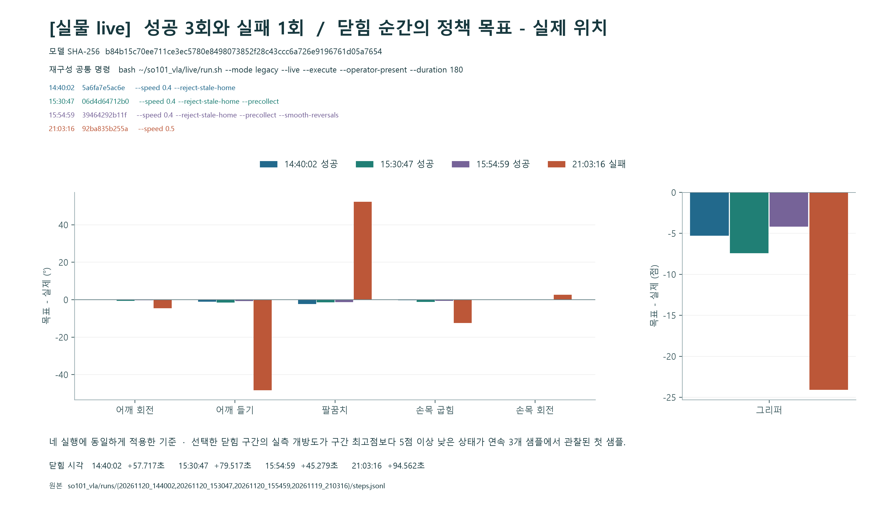

실패 실행은 `20261119_210316`, 대표 이벤트 3이다. 당시 실행기 커밋 `92ba835b255ab400e31da856596d336fee4979a2`, 재구성 명령 `bash ~/so101_vla/live/run.sh --mode legacy --live --execute --operator-present --speed 0.5 --duration 180`.

원본 전송 로그의 model에서 같은 행 feedback.state를 뺐다. 구간은 최종 성공한 집기 또는 대표 실패 시도를 영상과 로그로 먼저 특정했다. 각 선택 구간에서 그 시점까지의 실측 개방도 최고점보다 5점 이상 감소한 상태가 3개 연속 전송 샘플에서 유지되는 최초 샘플을 네 실행에 공통 적용했다. 실행별 전체 최대 오차가 아니다. 기존 실패 분석의 +94.604초는 다른 닫힘 검출 조건을 사용했으므로 별도 값이다.

| 실행 | 탐색 구간 (초) | 닫힘 (초) | step | 어깨 회전 (°) | 어깨 들기 (°) | 팔꿈치 (°) | 손목 굽힘 (°) | 손목 회전 (°) | 그리퍼 (점) |
|---|---|---|---|---|---|---|---|---|---|
| 14:40:02 | 57.1–59.3 | 57.717 | 2537 | -0.22 | -1.13 | -2.37 | -0.33 | -0.18 | -5.30 |
| 15:30:47 | 79.1–80.4 | 79.517 | 3482 | -0.72 | -1.62 | -1.44 | -1.25 | -0.11 | -7.44 |
| 15:54:59 | 44.8–45.7 | 45.279 | 1996 | -0.34 | -0.79 | -1.34 | -0.62 | -0.17 | -4.18 |
| 21:03:16 | 93.8–94.92 | 94.562 | 4184 | -4.65 | -48.43 | +52.28 | -12.53 | +2.58 | -24.11 |

원본 위치는 Jetson의 `so101_vla/runs/<실행 ID>/steps.jsonl`과 `summary.json`이다. RUN은 각 실행 폴더를 가리킨다. 관제 프레임은 `mediflow-demo-check-iOcDlKaA/demo-video-*/` 아래 동일 run ID만 골랐다. 전송 행의 model은 보간된 정책 참조 목표, 실제 위치는 feedback.state, 부하는 feedback.loads.gripper다. 카메라 시각은 이벤트 프레임의 time_s에서 해당 소스 age_s를 뺀 값 또는 관제 captured에서 READY unix를 뺀 값이다.
